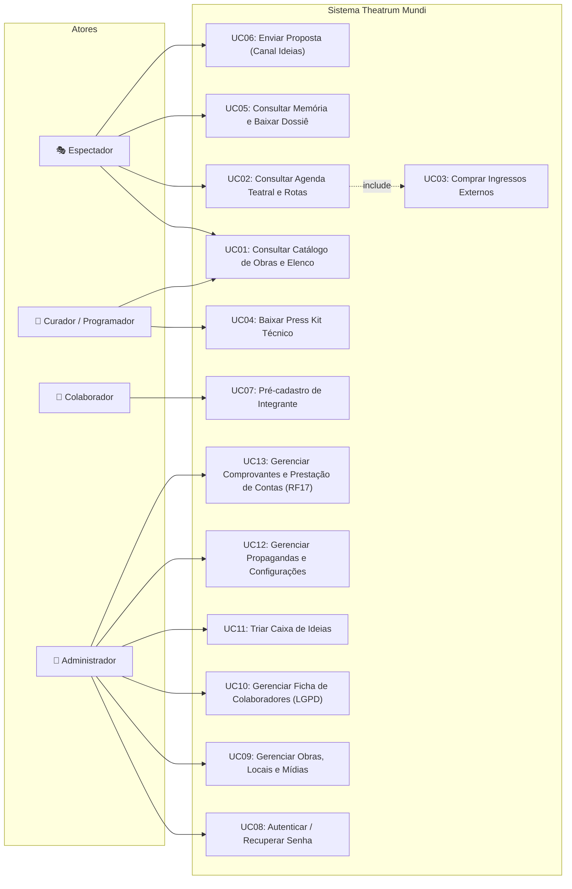

# UNIVERSIDADE DE VASSOURAS — UNIVASSOURAS
## CAMPUS UNIVERSITÁRIO DE MARICÁ
### CURSO DE BACHARELADO EM ENGENHARIA DE SOFTWARE

---

# RELATÓRIO TÉCNICO DE ENGENHARIA DE SOFTWARE — EXERCÍCIO 1
## PROJETO THEATRUM MUNDI: PLATAFORMA INTEGRADA DE DIFUSÃO, CIRCULAÇÃO E GESTÃO TEATRAL
### PARTE 1 — ENGENHARIA DE REQUISITOS DE SOFTWARE

* **Discente:** Fábio Pinto Figueiredo
* **Matrícula:** 202413741
* **Curso:** Bacharelado em Engenharia de Software — Campus Maricá/RJ
* **Orientação:** Corpo Docente de Engenharia de Software
* **Stakeholder:** Angelo Faria Turci (Diretor Geral da Cia Theatrum Mundi)
* **Repositório Oficial:** [https://github.com/pfFabio/projeto_teatro](https://github.com/pfFabio/projeto_teatro)
* **Aplicação em Produção (Web SPA):** [https://pffabio.github.io/projeto_teatro/](https://pffabio.github.io/projeto_teatro/)
* **API REST Backend (Nuvem Render):** https://projeto-teatro.onrender.com

---

## 1. Técnicas de Elicitação dos Requisitos

A elicitação de requisitos do projeto Theatrum foi conduzida através de uma abordagem empírica, colaborativa e iterativa (*Customer-Centric Engineering*), integrando cinco técnicas complementares:

### 1.1 Técnicas Empregadas e Dinâmica Metodológica
1. **Entrevistas Semiestruturadas com Stakeholder-Chave:**
   - Realizadas diretamente com **Angelo Faria Turci**, dramaturgo, encenador e diretor geral da companhia Theatrum Mundi.
   - Foco nos desafios operacionais de companhias independentes: dificuldade de circular espetáculos pelo interior do RJ e editais estaduais, dependência do envio manual e repetitivo de e-mails com anexos pesados (riders de luz/som de até 50 MB) e ausência de uma vitrine digital centralizada para curadores e público.
2. **Prototipação Evolutiva com Validação ao Vivo (Live Demos):**
   - Apresentação de protótipos navegáveis compartilhando tela via Google Meet durante as reuniões de alinhamento.
   - A demonstração interativa permitiu que o stakeholder percebesse imediatamente ruídos de usabilidade, levando à separação conceitual entre o catálogo artístico (*Obras*) e a logística cronológica de apresentações (*Agenda*).
3. **Análise Documental de Artefatos Oficiais de Produção (Engenharia Reversa de Requisitos):**
   - Mineração detalhada de regras e dados a partir de documentos reais da companhia:
     - *Edital Fluxos Fluminenses da SECEC/RJ* (comprovação de fomento público estadual);
     - *Rider Técnico de Luz e Som* e *Projeto de Encenação de "Da Janela, o Mar"*;
     - *Dramaturgia poética integral*;
     - *Dossiê Histórico e Portfólio Artístico (2012–2026)*;
     - *Ficha Técnica da Produção* (16 profissionais catalogados com funções).
4. **Elicitação Assíncrona e Análise de Mensagens (WhatsApp):**
   - Coleta de evidências operacionais imediatas durante o processo criativo. O stakeholder enviou prints de formulários legados da companhia detalhando 23 campos necessários para gerenciar o elenco (medidas corporais para figurinos, registros profissionais DRT/OMB e prontuário médico para circulação).
5. **Brainstorming e Sessões JAD (Joint Application Design):**
   - Sessões de cocriação que geraram quatro novos módulos do sistema: *Área de Downloads Técnicos (Press Kit)* na obra em cartaz, página *Memória da Companhia* com linha do tempo, vitrine de *Projetos Futuros* em concepção e o canal público de diálogo *"Tem uma Ideia?"*.

### 1.2 Evidências Concretas da Aplicação das Técnicas
* **Ata de Reunião #01 (28/08/2026):** Arquivo `docs/reunioes/2026-08-28_reuniao_01_stakeholder.md`. Formalizou a separação entre Obras e Agenda e o status *Em Repertório*.
* **Ata de Reunião #02 (07/10/2026):** Arquivo `docs/reunioes/2026-10-07_reuniao_02_stakeholder.md`. Documentou novos requisitos (Press Kit, Memória, Projetos Futuros e prazo estrito de segurança).
* **Transcrição Literal da Reunião #02:** Arquivo `docs/reunioes/ixv-kgvh-bqc (2026-10-07 10_57 GMT-3) - Transcript.docx` (gravação integral de 30 minutos em áudio e texto com todas as falas do diretor Angelo Turci e do desenvolvedor Fábio Figueiredo).
* **Prints de Tela WhatsApp:** Arquivos em `docs/reunioes/reuniao 2/WhatsApp Image 2026-10-07 at 11.07.22.jpeg` e `11.25.09.jpeg` evidenciando campos cadastrais solicitados pelo diretor.
* **Documentos Técnicos Oficiais:** Disponibilizados em `client/public/downloads/*.pdf` para download público.

---

## 2. Requisitos Funcionais (RF) Levantados e Priorização MoSCoW

### 2.1 Catálogo Completo de Requisitos Funcionais

| Identificador | Título do Requisito Funcional | Descrição Detalhada |
|:---:|---|---|
| **RF01** | Catálogo e Classificação de Obras | O sistema deve exibir as peças teatrais classificadas por status (`EM_CARTAZ`, `EM_REPERTORIO`, `PROJETO_FUTURO`, `ENCERRADA`), com cartaz, sinopse e ficha técnica. |
| **RF02** | Apresentação Visual e Galeria | A página de detalhes da obra deve apresentar cartaz em formato widescreen no topo, ficha técnica e carrossel de fotos oficiais de alta resolução. |
| **RF03** | Agenda Teatral com Georreferenciamento | O sistema deve listar cronologicamente as apresentações ativas com data, horário, teatro, mapa Leaflet interativo e botão para abrir rotas no Google Maps. |
| **RF04** | Integração com Bilheteria Externa | O sistema deve permitir cadastro de URLs de venda de ingressos (Sympla, Fever, etc.) e exibir botão de ação (*"Comprar Ingresso"*) na obra e na Agenda. |
| **RF05** | Downloads Técnicos (Press Kit) | Para obras com status `EM_CARTAZ`, o sistema deve exibir seção de downloads de arquivos oficiais (Rider Técnico, Projeto, Dramaturgia e Ficha Técnica em PDF). |
| **RF06** | Acervo Histórico ("Memória") | O sistema deve apresentar linha do tempo dos marcos da companhia desde 2012, espetáculos premiados, filtros temáticos e download do dossiê em PDF. |
| **RF07** | Vitrine de Projetos Futuros | A página inicial deve possuir setor em destaque apresentando espetáculos autorais em fase de concepção e laboratório cênico (`PROJETO_FUTURO`). |
| **RF08** | Formulário Público "Tem uma Ideia?" | A página inicial deve disponibilizar formulário público para recebimento de propostas artísticas de dramaturgos e produtores, com aceite explícito de LGPD. |
| **RF09** | Painel Administrativo de Ideias | O administrador deve poder visualizar, filtrar por status (`NOVA`, `LIDA`, `RESPONDIDA`, `ARQUIVADA`), consultar dados de contato e gerenciar propostas enviadas. |
| **RF10** | Formulário Público de Colaboradores | Artistas e técnicos devem poder enviar dados para cadastro de interesse de atuação na companhia, com termos de privacidade em conformidade com a LGPD. |
| **RF11** | Gestão de Ficha Cadastral no Admin | O administrador autenticado deve poder consultar e editar os 23 campos estendidos de colaboradores (identificação, contato, documentos e prontuário médico). |
| **RF12** | Mascaramento de Dados Sensíveis (LGPD) | A API pública deve suprimir CPF, RG, celular, endereço e dados de saúde de colaboradores em consultas públicas, restringindo-os à sessão de administrador autenticado. |
| **RF13** | Autenticação Flexível do Administrador | O sistema deve permitir login administrativo tanto pelo e-mail quanto pelo nome de usuário (`admin`), gerando token JWT de sessão. |
| **RF14** | Recuperação de Senha ("Esqueci minha senha") | O sistema deve permitir solicitação de recuperação de credencial, gerando token temporário (validade de 1 hora) para redefinição segura de senha. |
| **RF15** | Alteração de Senha Autenticada | O administrador deve poder alterar sua senha dentro do painel de controle validando a credencial atual. |
| **RF16** | Gestão de Comunicados e Propagandas | O administrador deve poder criar, ordenar e ativar comunicados institucionais exibidos em carrossel na página inicial. |
| **RF17** | Gestão de Comprovantes de Despesa | O sistema deve permitir ao administrador anexar notas e comprovantes de pagamentos (PDF/imagens) associados a peças e produções. |
| **RF18** | Interações Lúdicas ("Quarto do Joca") | Experiência interativa com animações infantis e narrativa lúdica para a peça futura. |

### 2.2 Matriz de Priorização MoSCoW

| Classificação MoSCoW | Requisitos Alocados | Racional Técnico e Estratégico |
|---|:---:|---|
| **Must Have (Obrigatório)** | **RF01, RF02, RF03, RF04, RF05, RF06, RF08, RF10, RF11, RF12, RF13, RF14, RF15** | Essencial para o funcionamento do sistema contratado: divulgação de espetáculos, orientação de público via mapa, venda de ingressos, downloads para curadores, linha do tempo da companhia e segurança total em compliance com a LGPD. |
| **Should Have (Importante)** | **RF07, RF09, RF16** | Agrega valor competitivo e institucional direto: vitrine de projetos futuros na Home, triagem de parcerias recebidas e canal de propagandas da companhia. |
| **Could Have (Desejável) [Entregue no MVP]** | **RF17** | Comprovantes de pagamento de produções: agrega conveniência de gestão interna e prestação de contas de editais. Entregue integralmente via TDD (Red-Green-Refactor) com 41 novos testes automatizados e proteção de sigilo financeiro (HTTP 403). |
| **Won't Have (Postergado)** | **RF18** | Interatividade do espetáculo *Quarto do Joca*: postergado para 2027 por depender de assets de arte e animações autorais ainda em desenvolvimento. |

---

## 3. Requisitos Não Funcionais (RNF) Levantados

Os requisitos não funcionais foram estruturados segundo as diretrizes da norma internacional **NBR ISO/IEC 25010 (Modelos de Qualidade de Produto de Software)** e da **Lei Geral de Proteção de Dados (Lei nº 13.709/2018)**:

### 3.1 Segurança (ISO 25010: Security & LGPD)
* **RNF-SEG-01 (Criptografia de Senhas):** Todas as senhas de usuários e administradores devem ser transformadas em hashes unidirecionais criptografados via algoritmo **Bcrypt** com fator de custo de 10 rounds antes da persistência.
* **RNF-SEG-02 (Autenticação Stateless JWT):** Rotas administrativas privadas devem exigir cabeçalho HTTP `Authorization: Bearer <token>`, com tokens assinados via HMAC SHA-256 e expiração máxima de 24 horas.
* **RNF-SEG-03 (Minimização e Mascaramento de Dados LGPD - Art. 6º, III):** Rotas públicas da API jamais devem expor dados fiscais ou sensíveis (CPF, RG, celular, endereço e histórico de saúde). O Prisma executa projeção seletiva no controller/service antes de responder.
* **RNF-SEG-04 (Proteção contra Ameaças Web e Rate Limit):** O backend Express deve aplicar cabeçalhos HTTP defensivos via middleware **Helmet**, política estrita de **CORS** para a origem autorizada do GitHub Pages e limitador de taxa (**express-rate-limit**) com no máximo 20 tentativas por 15 minutos na rota de login e 10 requisições por hora no formulário de ideias.

### 3.2 Desempenho e Eficiência (ISO 25010: Performance Efficiency)
* **RNF-DES-01 (Tempo de Resposta dos Serviços):** O tempo de resposta para operações de leitura paginada de obras, agenda e memória deve ser inferior a **300 ms** em condições nominais de rede.
* **RNF-DES-02 (Divisão de Pacotes e Bundle Size):** A aplicação cliente Vite deve implementar code-splitting (`React.lazy` e `Suspense`) e chunking manual de bibliotecas pesadas (`vendor` e `leaflet`), mantendo o bundle inicial abaixo de **250 kB** comprimido em Gzip.
* **RNF-DES-03 (Serviço de Mídia Otimizado):** As imagens oficiais e downloads técnicos do repertório devem ser servidos diretamente pela CDN global do GitHub Pages para renderização instantânea, possuindo fallback de dupla persistência no banco PostgreSQL do Render (`prisma.arquivo`).

### 3.3 Usabilidade e Acessibilidade (ISO 25010: Usability & WCAG 2.1 AA)
* **RNF-USA-01 (Design Responsivo Fluido):** A interface deve renderizar perfeitamente e sem quebras visuais em telas com resolução a partir de **320 px** (smartphones) até monitores desktop widescreen de alta densidade (4K).
* **RNF-USA-02 (Contraste e Legibilidade):** A paleta de cores deve atender ao critério de contraste mínimo de **4.5:1** para texto normal e **3:1** para texto grande/títulos conforme preconizado pelas diretrizes WCAG 2.1 nível AA.
* **RNF-USA-03 (Feedback Visual Imediato):** Toda submissão assíncrona deve desabilitar os botões de ação para evitar duplicação, exibir animação de progresso (*spinner*) e apresentar mensagens de confirmação claras e em português.

### 3.4 Confiabilidade e Disponibilidade (ISO 25010: Reliability)
* **RNF-DIS-01 (Disponibilidade Contínua):** O frontend deve atingir 99,9% de disponibilidade global através da infraestrutura de CDN do GitHub Pages, operando de forma desacoplada da API de dados.
* **RNF-DIS-02 (Tolerância a Falhas e Cold Starts):** O cliente HTTP Axios deve possuir timeout estendido de **60.000 ms** e mecanismos de fallback canônico estático (`PECAS_OFICIAIS`), garantindo que o catálogo e as fotografias continuem navegáveis mesmo se a API gratuita entrar em repouso (*sleep mode*).

### 3.5 Compatibilidade e Interoperabilidade (ISO 25010: Compatibility)
* **RNF-COM-01 (Suporte Multi-Navegador e Cross-Platform):** A interface SPA deve operar com total fidelidade funcional e visual nos principais navegadores modernos do mercado (Google Chrome v110+, Mozilla Firefox v115+, Microsoft Edge v110+ e Apple Safari / iOS Safari v16+), sem requerer plugins legados proprietários.
* **RNF-COM-02 (Interoperabilidade com Serviços Externos):** O sistema deve interoperar nativamente com a API de bilheteria e links profundos (Deep Linking com Sympla e Fever), com o serviço de geolocalização do OpenStreetMap (via Leaflet 1.9) e com o ecossistema mobile de mapas (URI scheme padrão para abertura de rotas no aplicativo Google Maps).

### 3.6 Escalabilidade (ISO 25010: Scalability)
* **RNF-ESC-01 (Escalabilidade Horizontal Stateless da API):** O backend Express deve manter arquitetura 100% *stateless* baseada em tokens JWT auto-contidos e sessões desvinculadas de memória de servidor, permitindo que novas réplicas de contêineres sejam instanciadas no Render ou Kubernetes sob picos de tráfego sem quebra de estado.
* **RNF-ESC-02 (Paginação e Eficiência de Consulta no Banco):** Todas as listagens de catálogo (peças, colaboradores, ideias e histórico) devem implementar paginação indexada server-side via Prisma ORM (`skip`/`take`), prevenindo o consumo excessivo de memória RAM e sobrecarga de I/O de rede à medida que o acervo documental e de mensagens se expande.

### 3.7 Manutenibilidade e Testabilidade (ISO 25010: Maintainability)
* **RNF-MAN-01 (Arquitetura Limpa em Camadas):** O código deve seguir estrita separação de responsabilidades (Rotas, Middlewares, Validadores, Controllers, Services e ORM Prisma).
* **RNF-MAN-02 (Cobertura de Testes de Regressão):** A base de código deve possuir testes unitários e de integração automatizados em 100% das regras críticas de negócio e segurança, superando 80% de cobertura de código.

---

## 4. Histórias de Usuário (User Stories) e Critérios de Aceitação BDD

### 4.1 Catálogo de User Stories com Especificação Gherkin

#### [US01] — Consulta e Detalhes de Obras Teatrais
* **Como** espectador ou amante de teatro,  
* **Quero** visualizar a página da obra com cartaz em destaque, galeria de fotos e ficha técnica,  
* **Para que** eu possa compreender a proposta poética do espetáculo antes de assistir.
```gherkin
Cenário: Visualização bem-sucedida de detalhes de obra teatral
  Dado que o espetáculo "Da Janela, o Mar" está catalogado no sistema
  Quando o espectador acessa a rota "/obras/1"
  Então o sistema renderiza o banner principal e fotos oficiais de Renato Mangolin
  E exibe a sinopse poética do espetáculo e a listagem de integrantes do elenco
  E apresenta botões de ação para compra de ingressos e consulta de datas na Agenda
```

#### [US02] — Localização de Apresentações na Agenda Teatral
* **Como** espectador de teatro,  
* **Quero** consultar as sessões em cartaz com horários, teatros e mapa interativo,  
* **Para que** eu consiga traçar minha rota de deslocamento até o teatro.
```gherkin
Cenário: Visualizar localização de apresentação e abrir no Google Maps
  Dado que existem sessões cadastradas para o Centro de Artes da UFF
  Quando o espectador navega até a página "/agenda"
  Então visualiza o card com data, horário de início e endereço completo
  Quando clica no botão "Ver no Mapa 📍"
  Então um modal com mapa Leaflet é carregado com marcador nas coordenadas exatas
  E o botão "Abrir no Google Maps ↗" direciona para o traçado de rotas em nova aba
```

#### [US03] — Download de Materiais Técnicos (Press Kit) por Curadores
* **Como** curador de festival ou programador de centro cultural,  
* **Quero** baixar o rider técnico e projeto de encenação de uma obra em cartaz,  
* **Para que** eu possa avaliar imediatamente a viabilidade técnica de som, luz e palco sem solicitar por e-mail.
```gherkin
Cenário: Curador baixa rider técnico de peça em temporada
  Dado que a peça "Da Janela, o Mar" possui o status "EM_CARTAZ"
  Quando o curador abre a página da peça
  Então visualiza a seção "Informações Técnicas & Downloads"
  E ao clicar no botão "Baixar ↓" do Rider Técnico
  Então o navegador inicia o download do arquivo "RIDER_TECNICO_Da_Janela_o_Mar.pdf"
```

#### [US04] — Envio de Proposta Artística pelo Canal "Tem uma Ideia?"
* **Como** dramaturgo ou produtor parceiro,  
* **Quero** enviar uma proposta de espetáculo ou texto autoral pela página inicial,  
* **Para que** a direção da Theatrum Mundi conheça minha ideia para futuras montagens.
```gherkin
Cenário: Submissão de proposta artística com consentimento LGPD
  Dado que o usuário preenche nome, e-mail, telefone e a descrição de sua proposta
  E marca a caixa de autorização de tratamento de dados pessoais conforme a LGPD
  Quando aciona o botão "Enviar Minha Proposta"
  Então o sistema armazena a mensagem na tabela "mensagens_ideias" com status "NOVA"
  E exibe confirmação visual de agradecimento na tela
```

#### [US05] — Gestão Segura de Colaboradores e Proteção de Privacidade
* **Como** diretor administrativo da companhia,  
* **Quero** manter a ficha cadastral completa dos integrantes (com documentos e saúde),  
* **Para que** a equipe esteja respaldada em viagens de turnê enquanto os dados sigilosos são resguardados de acessos externos.
```gherkin
Cenário: Ocultação de dados sigilosos para requisições não autenticadas
  Dado que o colaborador possui CPF, RG e histórico de alergias cadastrados
  Quando uma requisição pública invoca o endpoint "GET /api/colaboradores"
  Então a resposta HTTP 200 não deve conter os campos "cpf", "rg" e "saude"
  Quando o administrador autentica-se com JWT e consulta o colaborador no painel
  Então todos os 23 campos cadastrais são exibidos de forma irrestrita
```

#### [US06] — Recuperação e Redefinição de Senha do Administrador
* **Como** administrador da plataforma,  
* **Quero** solicitar recuperação de acesso caso esqueça minha credencial,  
* **Para que** eu consiga redefinir minha senha de forma autônoma e segura.
```gherkin
Cenário: Redefinição de senha através de token temporário
  Dado que o administrador solicita recuperação para o usuário "admin"
  Quando o sistema valida a solicitação
  Então emite um token com validade de 60 minutos
  Quando o administrador envia o token e sua nova senha
  Então a nova senha é gravada com hash Bcrypt e a mensagem de sucesso é retornada
```

#### [US07] — Gestão de Comprovantes e Prestação de Contas (RF17)
* **Como** administrador financeiro / produtor da companhia,  
* **Quero** cadastrar notas fiscais, recibos e comprovantes anexando arquivos (PDF/imagens) com título, descrição opcional, valor, data (`dataComprovante`) e categoria, associando-os opcionalmente a peças e colaboradores,  
* **Para que** eu mantenha a prestação de contas de editais culturais (ex: Lei Paulo Gustavo, SESC) organizada e protegida sob sigilo financeiro.
```gherkin
Cenário: Cadastro e consulta sigilosa de comprovante financeiro
  Dado que o administrador está autenticado no painel de controle
  Quando ele envia um comprovante com título, valor, data (YYYY-MM-DD), categoria e anexo válido (PDF, PNG, JPG, WebP)
  Então o comprovante é persistido e associado à peça e ao colaborador selecionados
  E a rota pública de arquivos bloqueia qualquer acesso direto não autorizado com status HTTP 403 Forbidden
  E apenas administradores com token JWT válido conseguem visualizar e baixar o documento
```

### 4.2 Comparativo: Product Backlog Inicial vs. Backlog Atual

| Item do Backlog Inicial (Sprint 0 / Ata #01) | Item do Backlog Atualizado e Entregue (Pós Ata #02) | Situação de Entrega |
|---|---|:---:|
| CRUD Básico de Peças e Sinopse | Catálogo com 4 Status (`EM_CARTAZ`, `EM_REPERTORIO`, `PROJETO_FUTURO`, `ENCERRADA`) e Banner Hero Widescreen | 🟢 Entregue |
| Cadastro Simples de Colaboradores (7 campos) | Ficha Estendida com 23 campos em 5 sub-abas e mascaramento LGPD automático | 🟢 Entregue |
| Lista de Peças e Datas em tela única | Separação conceitual Obras × Agenda com Leaflet interativo e rotas no Google Maps | 🟢 Entregue |
| *Não previsto no início* | Seção de Downloads Técnicos (Press Kit) em PDF para obras em cartaz | 🟢 Entregue |
| *Não previsto no início* | Página Memória e Acervo Histórico (2012–2026) com download do portfólio em PDF | 🟢 Entregue |
| *Não previsto no início* | Canal Público "Tem uma ideia?" na Home e painel de triagem no Admin | 🟢 Entregue |
| *Não previsto no início* | Botão dinâmico de compra de ingressos integrado com Sympla na Obra e na Agenda | 🟢 Entregue |
| Login por e-mail hardcoded | Autenticação por login flexível (`admin`), recuperação de senha e troca de credencial | 🟢 Entregue |
| Upload local em disco | Dupla persistência binária no PostgreSQL para tolerar o filesystem efêmero do Render | 🟢 Entregue |
| Comprovantes de Despesa (RF17) | Módulo completo de Comprovantes com upload de notas/recibos (PDF/img), métricas por categoria, associação a peças/colaboradores e sigilo financeiro blindado (HTTP 403) | 🟢 Entregue |

---

## 5. Modelagem UML de Requisitos

### 5.1 Diagrama de Casos de Uso Geral



### 5.2 Especificação Formal dos Casos de Uso Críticos

#### [UC02] Consultar Agenda Teatral e Rotas
* **Ator Principal:** Espectador / Visitante Geral.
* **Atores Secundários:** Provedor OpenStreetMap / Leaflet, Google Maps.
* **Pré-condições:** Sessões teatrais ativas com data, horário e localização cadastradas.
* **Pós-condição:** O espectador obtém informações logísticas da apresentação, visualiza a localização no mapa ou é redirecionado para comprar ingresso.
* **Fluxo Principal:**
  1. O espectador clica no menu **Agenda**.
  2. O sistema faz requisição à API e renderiza a listagem cronológica de apresentações.
  3. O espectador utiliza a barra de busca por peça ou filtro por cidade.
  4. O espectador clica no botão **"Ver no Mapa 📍"** de uma sessão específica.
  5. O sistema abre modal contendo mapa interativo centrado nas coordenadas de latitude/longitude do teatro.
  6. O espectador clica em **"Abrir no Google Maps ↗"** para traçar rota de deslocamento.
* **Fluxo Alternativo (Compra de Ingresso):**
  - No passo 3, caso a sessão possua venda ativa, o espectador clica em **"🎟️ Comprar Ingresso"** e é direcionado à bilheteria oficial (Sympla) em nova aba.

#### [UC04] Baixar Press Kit Técnico de Obra em Cartaz
* **Ator Principal:** Programador de Festival, Curador ou Gestor de Teatro.
* **Pré-condições:** A peça deve estar com status `EM_CARTAZ` e possuir downloads cadastrados.
* **Pós-condição:** O arquivo técnico solicitado é baixado com sucesso em formato PDF.
* **Fluxo Principal:**
  1. O curador navega até a página da obra em temporada.
  2. O sistema detecta o status `EM_CARTAZ` e renderiza a seção **"Informações Técnicas & Downloads"**.
  3. O curador clica no botão **"Baixar ↓"** do documento desejado (Rider Técnico, Projeto, Dramaturgia ou Ficha Técnica).
  4. O navegador realiza o download direto do arquivo PDF.
* **Fluxo de Exceção (Obra fora de temporada):**
  - Caso o espetáculo tenha status `EM_REPERTORIO`, `PROJETO_FUTURO` ou `ENCERRADA`, a seção de downloads técnicos é omitida da interface.

#### [UC10] Gerenciar Ficha de Colaboradores com Proteção LGPD
* **Ator Principal:** Administrador do Theatrum Mundi.
* **Pré-condições:** Administrador autenticado com token JWT ativo.
* **Pós-condição:** Os dados sensíveis são gravados no banco relacional sob isolamento de privilégios.
* **Fluxo Principal:**
  1. O administrador acessa o painel de controle e clica na aba **Colaboradores**.
  2. O sistema lista os integrantes com fotos e funções artísticas.
  3. O administrador clica em editar (`✏️`).
  4. O sistema abre modal estruturado em 5 sub-abas (*Identificação, Contato, Documentos Sigilosos, Saúde & Medidas, Histórico*).
  5. O administrador preenche/atualiza os campos sensíveis (CPF, RG, alergias médicas, medidas de figurino).
  6. O administrador aciona **"Salvar Alterações"**.
  7. O backend valida os dados (`colaboradorValidator.js`) e persiste a alteração no PostgreSQL.
* **Fluxo de Exceção (Acesso Não Autorizado):**
  - Se uma requisição desautenticada tentar atualizar ou ler dados sigilosos via API, o middleware `auth.js` intercepta e retorna status `HTTP 401 Unauthorized`.

---

## 6. Matriz de Rastreabilidade Bidirecional

| ID Requisito | Caso de Uso | Componente / Arquivo Frontend | Rota / Serviço Backend | Arquivo de Teste Automatizado |
|:---:|:---:|---|---|---|
| **RF01** / **RF02** | UC01 | `client/src/pages/PecasPage.jsx`<br>`client/src/pages/PecaDetalhesPage.jsx` | `server/src/routes/pecas.js`<br>`server/src/services/pecaService.js` | `client/src/__tests__/components/PecaDetalhesPage.test.jsx`<br>`server/src/__tests__/validators/pecaValidator.test.js` |
| **RF03** | UC02 | `client/src/pages/AgendaPage.jsx`<br>`client/src/components/common/MapView.jsx` | `server/src/controllers/locaisController.js`<br>`server/src/services/pecaService.js` | `client/src/__tests__/components/AgendaPage.test.jsx` |
| **RF04** | UC02, UC03 | `client/src/pages/PecaDetalhesPage.jsx`<br>`client/src/pages/AgendaPage.jsx` | Campo `linkIngresso` na tabela `Peca`<br>`server/src/services/pecaService.js` | `client/src/__tests__/components/AgendaPage.test.jsx`<br>`client/src/__tests__/components/PecaDetalhesPage.test.jsx` |
| **RF05** | UC04 | `client/src/pages/PecaDetalhesPage.jsx` | Tabela `DownloadTecnico`<br>`server/src/controllers/pecasController.js` | `client/src/__tests__/components/PecaDetalhesPage.test.jsx` |
| **RF06** | UC05 | `client/src/pages/MemoriaPage.jsx`<br>`client/src/components/layout/Header.jsx` | `server/src/routes/memoria.js`<br>`server/src/services/memoriaService.js` | `server/src/__tests__/services/memoriaService.test.js`<br>`client/src/__tests__/components/Header.test.jsx` |
| **RF07** | UC01 | `client/src/pages/HomePage.jsx` | `server/src/constants/statusPeca.js` | `client/src/__tests__/components/HomePage.test.jsx`<br>`client/src/__tests__/constants/statusPeca.test.js` |
| **RF08** / **RF09** | UC06, UC11 | `client/src/pages/HomePage.jsx`<br>`client/src/components/admin/AbaIdeias.jsx` | `server/src/routes/ideias.js`<br>`server/src/services/ideiaService.js` | `server/src/__tests__/services/ideiaService.test.js`<br>`client/src/__tests__/components/AbaIdeias.test.jsx` |
| **RF10** / **RF11** | UC07, UC10 | `client/src/pages/ColaboradorPage.jsx`<br>`client/src/components/admin/AbaColaboradores.jsx` | `server/src/routes/colaboradores.js`<br>`server/src/services/colaboradorService.js` | `server/src/__tests__/validators/colaboradorValidator.test.js` |
| **RF12** (LGPD) | UC10 | Projeção segura de tela no cliente | Regra `ehAdmin` em `colaboradorService.js` | `server/src/__tests__/middleware/auth.test.js`<br>`server/src/__tests__/validators/colaboradorValidator.test.js` |
| **RF13**..**15** | UC08 | `client/src/components/admin/AdminLogin.jsx`<br>`client/src/components/admin/AbaConfig.jsx` | `server/src/routes/auth.js`<br>`server/src/services/authService.js` | `server/src/__tests__/services/authService.test.js`<br>`client/src/__tests__/components/AdminLogin.test.jsx` |
| **RF16** | UC12 | `client/src/components/common/PropagandasSection.jsx` | `server/src/routes/propagandas.js` | `server/src/__tests__/routes/propagandas.test.js` |
| **RNF-SEG** | Todos | `client/src/services/api.js` | `server/src/middleware/auth.js`<br>`server/src/app.js` (Helmet/CORS/Limiter) | `server/src/__tests__/middleware/auth.test.js` |
| **RNF-DES** | Todos | `client/vite.config.js`<br>`client/src/App.jsx` | Tabela `Arquivo` no PostgreSQL Render<br>`server/src/services/fileService.js` | `server/src/__tests__/services/fileService.test.js` |

