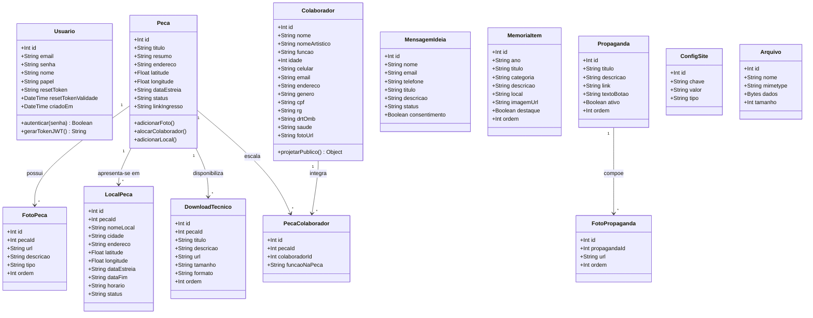
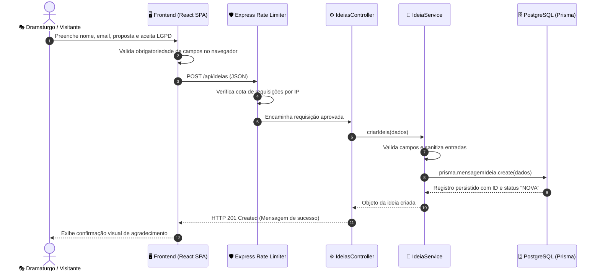
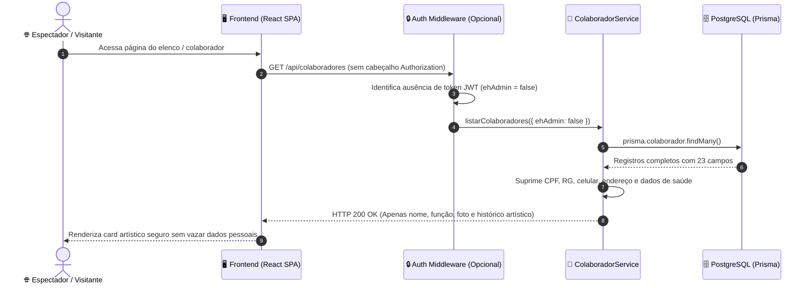
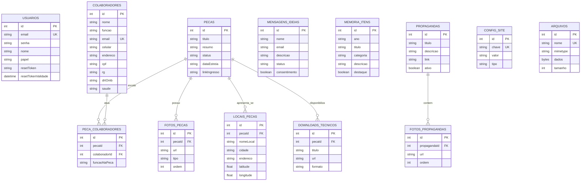

# UNIVERSIDADE DE VASSOURAS — UNIVASSOURAS
## CAMPUS UNIVERSITÁRIO DE MARICÁ
### CURSO DE BACHARELADO EM ENGENHARIA DE SOFTWARE

---

# RELATÓRIO TÉCNICO DE ENGENHARIA DE SOFTWARE — EXERCÍCIO 2
## PROJETO THEATRUM MUNDI: PLATAFORMA INTEGRADA DE DIFUSÃO, CIRCULAÇÃO E GESTÃO TEATRAL
### PARTE 2 — ARQUITETURA, MODELAGEM, UX E SEGURANÇA

* **Discente:** Fábio Pinto Figueiredo
* **Matrícula:** 202413741
* **Curso:** Bacharelado em Engenharia de Software — Campus Maricá/RJ
* **Orientação:** Corpo Docente de Engenharia de Software
* **Stakeholder:** Angelo Faria Turci (Diretor Geral da Cia Theatrum Mundi)
* **Repositório Oficial:** [https://github.com/pfFabio/projeto_teatro](https://github.com/pfFabio/projeto_teatro)
* **Aplicação em Produção (Web SPA):** [https://pffabio.github.io/projeto_teatro/](https://pffabio.github.io/projeto_teatro/)
* **API REST Backend (Nuvem Render):** https://projeto-teatro.onrender.com

---

## 1. Arquitetura de Software

### 1.1 Estilo e Padrão Arquitetural Escolhido
A solução adota a arquitetura **SPA + RESTful API em Camadas Desacopladas (Layered Architecture)** com integração a **Object-Relational Mapping (Prisma ORM)**:

```
[ Cliente: Single Page Application (React 19 + Vite + Vanilla CSS Tokens) ]
                                    │  HTTP/JSON (RESTful + JWT Bearer)
                                    ▼
[ Camada de Roteamento e Proteção HTTP (Express + Helmet + CORS + Rate Limiters) ]
                                    │
[ Camada de Validação Defensiva (Validadores Puros Nativos Zero-Dependency) ]
                                    │
[ Camada de Apresentação e Controle HTTP (Controllers Express) ]
                                    │
[ Camada de Serviços de Negócio e Mascaramento LGPD (Services de Domínio) ]
                                    │
[ Camada de Acesso a Dados e Mapeamento ORM (Prisma Client Abstraction) ]
                                    │  SQL Nativo Otimizado (TCP/5432)
                                    ▼
[ Banco de Dados Relacional: PostgreSQL (Render Managed Cloud Platform) ]
```

### 1.2 Justificativa Técnica da Escolha
1. **Desacoplamento e Independência de Deploy:** O frontend estático pode ser servido em alta velocidade pela CDN do GitHub Pages com custo zero e disponibilidade de 99,9%, enquanto o backend escala sob demanda no cluster Render.
2. **Manutenibilidade e Testabilidade Isolada (SOLID):** O padrão de camadas desacopladas garante que as regras de negócio residam exclusivamente nos *Services*, tornando-os 100% testáveis em memória sem necessidade de levantar servidores HTTP.
3. **Validação Defensiva sem Dependências Frágeis:** Em vez de adotar bibliotecas externas pesadas e propensas a quebras de breaking change (como Joi ou Yup), o projeto implementou validadores puros próprios (`authValidator.js`, `pecaValidator.js`, `colaboradorValidator.js`). Isso garante execução ultrarrápida (sub-milissegundo), tipagem segura e zero dependências vulneráveis na camada de validação.
4. **Segurança Centralizada:** O controle de acesso por token JWT e o mascaramento LGPD são aplicados nos middlewares e serviços do backend, garantindo que nenhum dado sigiloso trafegue na rede mesmo em caso de falha de interface.

---

## 2. Modelagem Estrutural e Comportamental

### 2.1 Diagrama de Classes UML (Todas as 13 Entidades do Domínio e Persistência)



### 2.2 Diagramas de Sequência dos Fluxos Principais

#### Fluxo 1: Efetivação de Submissão no Canal Público "Tem uma Ideia?" com LGPD


#### Fluxo 2: Consulta Pública de Colaboradores com Mascaramento LGPD


---

## 3. Modelagem de Dados

### 3.1 Níveis de Modelagem de Dados



A modelagem de dados do Theatrum Mundi percorre os três níveis formais da engenharia de software:

1. **Modelo Conceitual (MER):**
   - Focado na semântica de negócios do teatro independente: uma **Peça** congrega uma galeria de **Mídias**, distribui-se em múltiplos **Locais/Datas** de apresentação e aloca um elenco multidisciplinar de **Colaboradores** através da entidade associativa **PecaColaborador**. Peças em cartaz expõem **Downloads Técnicos** para curadores, enquanto a memória histórica institucional vive em **MemoriaItem**.
2. **Modelo Lógico Relacional (Esquema de Tabelas):**
   - Normalizado até a 3ª Forma Normal (3FN), contendo 13 entidades relacionais bem delimitadas com integridade referencial estrita (`ON DELETE CASCADE` para fotos e locais filhos da peça) e chaves exclusivas de negócio (e-mails únicos de colaboradores e usuários administradores; par único `[pecaId, colaboradorId]` na alocação).
3. **Modelo Físico (PostgreSQL & Prisma):**
   - Implementado diretamente no script `server/prisma/schema.prisma`. Emprega tipos de dados otimizados para PostgreSQL (`SERIAL`, `DOUBLE PRECISION` para geocoordenadas Leaflet, campos `TEXT` para sinopses e dramaturgias longas e tipo binário `BYTEA` na tabela `arquivos` para salvaguardar imagens e PDFs binariamente no banco contra a volatilidade do filesystem efêmero da hospedagem Render).

### 3.2 Dicionário de Dados Completo das 13 Tabelas do Sistema

#### 1. Tabela: `pecas` (Obras Teatrais)
| Coluna | Tipo PostgreSQL | Nulo | Chave | Descrição |
|---|---|:---:|:---:|---|
| `id` | SERIAL / INT | Não | PK | Identificador único da peça |
| `titulo` | VARCHAR(150) | Não | — | Título oficial do espetáculo |
| `resumo` | TEXT | Não | — | Sinopse poética e artística |
| `endereco` | TEXT | Sim | — | Endereço principal descritivo da sede/estreia |
| `latitude` | DOUBLE PRECISION | Sim | — | Coordenada GPS para geolocalização no mapa |
| `longitude` | DOUBLE PRECISION | Sim | — | Coordenada GPS para geolocalização no mapa |
| `dataEstreia` | VARCHAR(20) | Sim | — | Data da estreia oficial (formato YYYY-MM-DD) |
| `status` | VARCHAR(30) | Não | — | `EM_CARTAZ`, `EM_REPERTORIO`, `PROJETO_FUTURO`, `ENCERRADA` |
| `linkIngresso` | TEXT | Sim | — | URL da bilheteria oficial externa (Sympla/Fever) |

#### 2. Tabela: `colaboradores` (Artistas, Equipe Técnica e Proteção LGPD)
| Coluna | Tipo PostgreSQL | Nulo | Proteção LGPD | Descrição |
|---|---|:---:|:---:|---|
| `id` | SERIAL / INT | Não | Pública | Identificador único |
| `nome` / `nomeArtistico` | VARCHAR(120) | Não / Sim | Pública | Nome civil e identificação cênica |
| `funcao` | VARCHAR(100) | Não | Pública | Função primordial (Diretor, Ator, Iluminador) |
| `fotoUrl` | TEXT | Sim | Pública | Fotografia do perfil artístico |
| `historico` | TEXT | Sim | Pública | Minicurrículo cênico e trajetória teatral |
| `email` / `celular` | VARCHAR(100) | Não | 🔒 **Sigiloso** | Dados de contato direto (expostos apenas para admin) |
| `endereco` / `cidade` / `cep` | VARCHAR(150) | Não / Sim | 🔒 **Sigiloso** | Domicílio residencial do artista |
| `cpf` / `rg` | VARCHAR(25) | Sim | 🔒 **Sigiloso** | Documentação fiscal/civil (blindada contra vazamentos) |
| `saude` | TEXT | Sim | 🔒 **Sensível** | Prontuário de alergias e emergência médica (Art. 11 LGPD) |

#### 3. Tabela: `downloads_tecnicos` (Press Kit para Curadores)
| Coluna | Tipo PostgreSQL | Nulo | Chave | Descrição |
|---|---|:---:|:---:|---|
| `id` | SERIAL / INT | Não | PK | Identificador do download |
| `pecaId` | INT | Não | FK | Referência à tabela `pecas` (`ON DELETE CASCADE`) |
| `titulo` | VARCHAR(100) | Não | — | Nome do documento (ex: "Rider Técnico de Luz e Som") |
| `descricao` | TEXT | Sim | — | Resumo das especificações contidas no arquivo |
| `url` | TEXT | Não | — | Caminho do arquivo PDF para download |
| `formato` | VARCHAR(10) | Sim | — | Formato do arquivo (default: "PDF") |
| `ordem` | INT | Não | — | Ordem de disposição dos cards na tela |

#### 4. Tabela: `locais_pecas` (Sessões da Agenda e Georreferenciamento)
| Coluna | Tipo PostgreSQL | Nulo | Chave | Descrição |
|---|---|:---:|:---:|---|
| `id` | SERIAL / INT | Não | PK | Identificador único da sessão/local |
| `pecaId` | INT | Não | FK | Referência à peça associada (`ON DELETE CASCADE`) |
| `nomeLocal` | VARCHAR(120) | Não | — | Nome do teatro (ex: "Centro de Artes da UFF") |
| `cidade` | VARCHAR(100) | Não | — | Município e estado (ex: "Niterói, RJ") |
| `endereco` | TEXT | Não | — | Logradouro e número para traçado de rotas |
| `latitude` / `longitude` | DOUBLE PRECISION | Sim | — | Ponto geodésico para renderização no Leaflet |
| `horario` | VARCHAR(100) | Sim | — | Informação descritiva de dias e horários das sessões |

#### 5. Tabela: `mensagens_ideias` (Caixa de Propostas Artísticas)
| Coluna | Tipo PostgreSQL | Nulo | Chave | Descrição |
|---|---|:---:|:---:|---|
| `id` | SERIAL / INT | Não | PK | Identificador da mensagem |
| `nome` | VARCHAR(100) | Não | — | Nome do proponente |
| `email` | VARCHAR(100) | Não | — | E-mail de retorno do dramaturgo/produtor |
| `telefone` | VARCHAR(30) | Sim | — | WhatsApp para contato direto da direção |
| `descricao` | TEXT | Não | — | Texto da proposta ou sinopse do projeto |
| `consentimento` | BOOLEAN | Não | — | Flag comprobatória de aceite dos termos LGPD |
| `status` | VARCHAR(20) | Não | — | `NOVA`, `LIDA`, `RESPONDIDA`, `ARQUIVADA` |

#### 6. Tabela: `memoria_itens` (Linha do Tempo Histórica 2012–2026)
| Coluna | Tipo PostgreSQL | Nulo | Chave | Descrição |
|---|---|:---:|:---:|---|
| `id` | SERIAL / INT | Não | PK | Identificador do marco histórico |
| `ano` | VARCHAR(20) | Não | — | Ano ou biênio do marco (ex: "2012", "2017–2018") |
| `titulo` | VARCHAR(150) | Não | — | Título do espetáculo, prêmio ou oficina |
| `categoria` | VARCHAR(30) | Não | — | `ESPETACULO`, `PREMIO`, `FORMACAO`, `MARCO` |
| `descricao` | TEXT | Não | — | Memorial histórico da montagem e impacto cênico |
| `local` | VARCHAR(120) | Sim | — | Teatros e festivais de circulação cultural |
| `destaque` | BOOLEAN | Não | — | Indicador de destaque visual na linha do tempo |

#### 7. Tabelas Auxiliares, Administrativas e de Persistência (`usuarios`, `fotos_pecas`, `peca_colaboradores`, `propagandas`, `fotos_propagandas`, `config_site`, `arquivos`)
| Tabela | Chave Primária / Estrangeiras | Colunas Principais | Finalidade Arquitetural |
|---|---|---|---|
| `usuarios` | `id` (PK), `email` (UK) | `nome`, `email`, `senhaHash`, `role`, `resetToken`, `resetTokenExpires` | Credenciais de administradores, hash Bcrypt e tokens temporários de recuperação de senha |
| `fotos_pecas` | `id` (PK), `pecaId` (FK) | `url`, `legenda`, `ordem` | Carrossel de fotografias de cena por espetáculo (`ON DELETE CASCADE`) |
| `peca_colaboradores` | `id` (PK), `pecaId` (FK), `colaboradorId` (FK) | `papel`, índice único `[pecaId, colaboradorId]` | Tabela associativa `N:N` de ficha técnica com função específica na montagem |
| `propagandas` | `id` (PK) | `titulo`, `resumo`, `linkUrl`, `ativo`, `ordem` | Comunicados culturais e banners promocionais gerenciados pela direção |
| `fotos_propagandas` | `id` (PK), `propagandaId` (FK) | `url`, `legenda`, `ordem` | Galeria de imagens vinculadas aos comunicados (`ON DELETE CASCADE`) |
| `config_site` | `id` (PK), `chave` (UK) | `chave`, `valor`, `updatedAt` | Parâmetros institucionais dinâmicos em formato chave-valor |
| `arquivos` | `id` (PK), `nome` (UK) | `nome`, `mimeType`, `dados` (`BYTEA`), `createdAt` | Salvaguarda binária de imagens e PDFs no PostgreSQL contra perda em filesystem efêmero |

---

## 4. Design de Interface (UX/UI) e Acessibilidade

### 4.1 Wireframes e Fluxo de Telas (Protótipo Navegável)
A arquitetura de informação do Theatrum Mundi organiza a navegação em dois grandes fluxos orientados aos perfis de usuários:

```
[ FLUXO DO ESPECTADOR E CURADOR (PÚBLICO) ]
Início (Hero Widescreen + Carrossel de Obras + Projetos Futuros + Canal Ideias)
  ├── Obras (Filtros por Status: Em Cartaz, Repertório, Futuros, Encerradas)
  │     └── Detalhes da Obra (Banner Widescreen + Sinopse + Elenco + Press Kit em PDF)
  ├── Agenda (Sessões cronológicas + Modal de Mapa Leaflet + Rotas no Google Maps)
  └── Memória (Linha do tempo 3 colunas + Download do Portfólio Artístico em PDF)

[ FLUXO DO ADMINISTRADOR (RESTRITO / JWT) ]
Login (/admin com identificador 'admin' ou e-mail) ──► Dashboard Tabular
  ├── Aba Obras (CRUD de Peças, Carrossel de Fotos 16:9, Locais e Downloads)
  ├── Aba Colaboradores (Ficha estendida em 5 sub-abas com dados sigilosos)
  ├── Aba Ideias (Caixa de entrada Kanban para triagem de parcerias com link WhatsApp)
  ├── Aba Propagandas (Comunicados com ativação/desativação e ordenação)
  └── Aba Configurações (Alteração de senha e personalização de textos institucionais)
```

O protótipo navegável em alta fidelidade pode ser executado diretamente em produção no endereço:  
👉 **[https://pffabio.github.io/projeto_teatro/](https://pffabio.github.io/projeto_teatro/)**

### 4.2 Guia de Estilo (Design System Cênico)
* **Conceito Visual:** Estética teatral clássica e contemporânea (*"Black Box / Teatro Íntimo"*), com atmosfera acolhedora, iluminação cênica e tipografia editorial sofisticada.
* **Paleta de Cores (Design Tokens em Vanilla CSS):**
  * `Teal Cênico` (`#0DBDAD`): Acento principal de botões, tags interativas e foco.
  * `Fundo Marfim Claro` (`#F9F7F0`): Base suave que evita fadiga visual em leituras prolongadas.
  * `Escuro Cênico / Fundo Escuro` (`#0A0F14`): Fundo cinematográfico dos banners e do rodapé.
  * `Dourado Nobre` (`#D4AF37`): Destaques de premiações históricas e láureas nacionais.
* **Tipografia:**
  * *Títulos e Cabeçalhos:* **Playfair Display** (Serifada elegante, evocando cartazes clássicos).
  * *Textos de Leitura e Interface:* **Inter** / **Plus Jakarta Sans** (Sem serifa, alta legibilidade em telas pequenas).
* **Componentes Principais:**
  * `Hero Banner Widescreen`: Banner widescreen de alta escala que preenche o topo da tela com apresentação visual da obra.
  * `Timeline Editorial`: Linha do tempo em 3 colunas (Ano à esquerda, eixo central com nódulo em teal e card com badge temático à direita).
  * `Modal de Mapa Leaflet`: Caixa flutuante translúcida com geolocalização e botão de rota GPS.

### 4.3 Critérios de Acessibilidade (WCAG 2.1 Nível AA)
* **Navegação por Teclado:** Todos os botões, links de ingresso, carrosséis e formulários possuem indicadores visuais de foco (`:focus-visible`) e sequência lógica de tabulação (`tabindex`).
* **Rótulos e Leitores de Tela:** Imagens cênicas possuem atributos `alt` descritivos completos (com identificação dos fotógrafos oficiais) e elementos decorativos de fundo utilizam `aria-hidden="true"`.
* **Contraste de Cores:** Todos os pares de texto sobre fundo excedem a razão mínima de contraste de **4.5:1** para texto normal e **3:1** para títulos.
* **Mensagens e Estados:** Formulários comunicam erros e validações em português claro com alto contraste e alertas visuais nativos.

### 4.4 Validação do Protótipo com Usuários Reais
A validação de usabilidade foi conduzida em sessões remotas assistidas (*Moderated Usability Testing*) com o diretor geral da companhia, Angelo Faria Turci:
1. **Validação na Reunião #01 (28/08/2026):**
   - O stakeholder testou a navegação inicial e apontou confusão entre a listagem de peças artísticas e as datas pontuais de turnê.
   - *Ação corretiva de UX:* Foi aprovada a separação estrita entre o catálogo de espetáculos (*Obras*) e a programação logística de viagens (*Agenda* com mapa).
2. **Validação na Reunião #02 (07/10/2026):**
   - Na demonstração do protótipo ao vivo, o diretor aprovou o destaque visual do Hero da obra *"Da Janela, o Mar"* e solicitou que os links administrativos (*Seja Colaborador* e *Administração*) fossem transferidos para o rodapé, mantendo o menu superior 100% focado no espectador (*Início · Obras · Agenda · Memória*).
   - O diretor aprovou com louvor a criação do botão direto de download do Press Kit para contratantes e a possibilidade de visualizar a rota no Google Maps.

---

## 5. Segurança e Conformidade com a LGPD

### 5.1 Enquadramento na Lei Geral de Proteção de Dados (Lei nº 13.709/2018)
O sistema trata três categorias distintas de dados pessoais:
1. **Dados Pessoais Ordinários de Artistas/Técnicos (Nome, celular, e-mail, residência):**
   - *Base Legal:* **Execução de Contrato** (Art. 7º, V) para elaboração de contratos artísticos e borderôs; e **Consentimento** (Art. 7º, I) no formulário público de colaboradores.
2. **Dados Pessoais Sensíveis (Saúde, alergias e restrições alimentares):**
   - *Base Legal:* **Proteção da Vida e da Incolumidade Física** do titular (Art. 11, II, "e") durante o deslocamento em turnês e viagens de circulação cultural.
3. **Dados de Proponentes do Canal "Tem uma Ideia?":**
   - *Base Legal:* **Consentimento Livre e Informado** (Art. 7º, I) manifestado por checkbox obrigatória com redação explícita sobre a finalidade exclusiva de contato artístico.

### 5.2 Arquitetura de Proteção e Controles Técnicos
* **Isolamento em Runtime na API:** O serviço `colaboradorService.js` avalia o payload decodificado do JWT. Se `ehAdmin === false`, executa *data masking*, expurgando os campos sigilosos antes de serializar o JSON.
* **Criptografia e Hashing:** Senhas nunca são salvas em texto puro. Utiliza-se **Bcrypt com salt cost 10**.
* **Proteção de Camada de Transporte e Headers:** Uso obrigatório de HTTPS, proteção de cabeçalhos com **Helmet**, prevenção contra ataques XSS e controle estrito de origens via **CORS**.

