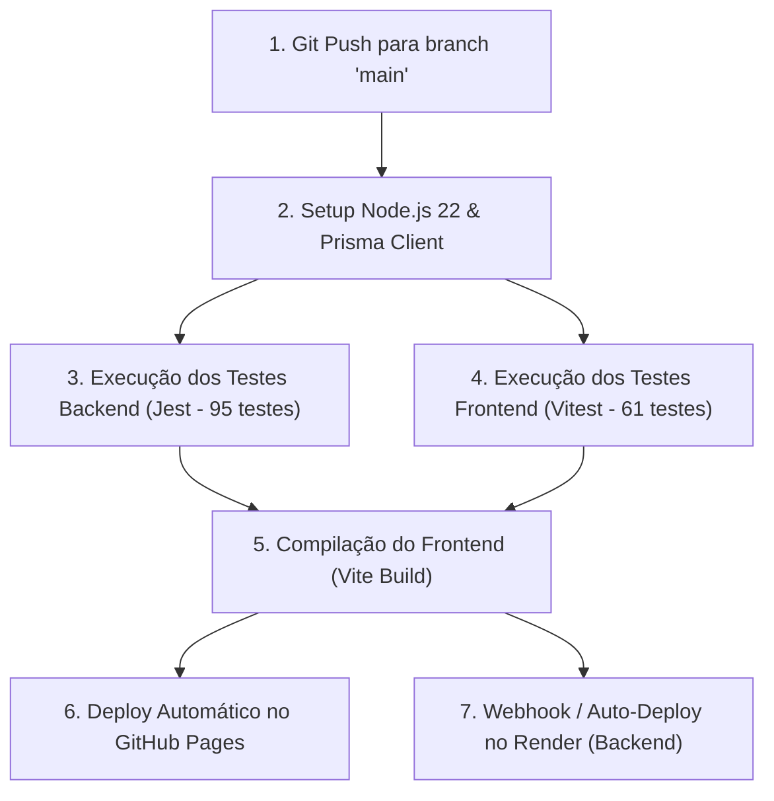

# UNIVERSIDADE DE VASSOURAS — UNIVASSOURAS
## CAMPUS UNIVERSITÁRIO DE MARICÁ
### CURSO DE BACHARELADO EM ENGENHARIA DE SOFTWARE

---

# RELATÓRIO TÉCNICO DE ENGENHARIA DE SOFTWARE — EXERCÍCIO 3
## PROJETO THEATRUM MUNDI: PLATAFORMA INTEGRADA DE DIFUSÃO, CIRCULAÇÃO E GESTÃO TEATRAL
### PARTE 3 — GESTÃO DE PROJETOS, DEVOPS E MVP

* **Discente:** Fábio Pinto Figueiredo
* **Matrícula:** 202413741
* **Curso:** Bacharelado em Engenharia de Software — Campus Maricá/RJ
* **Orientação:** Corpo Docente de Engenharia de Software
* **Stakeholder:** Angelo Faria Turci (Diretor Geral da Cia Theatrum Mundi)
* **Repositório Oficial:** [https://github.com/pfFabio/projeto_teatro](https://github.com/pfFabio/projeto_teatro)
* **Aplicação em Produção (Web SPA):** [https://pffabio.github.io/projeto_teatro/](https://pffabio.github.io/projeto_teatro/)
* **API REST Backend (Nuvem Render):** https://projeto-teatro.onrender.com

---

## 1. Metodologia de Desenvolvimento

### 1.1 Metodologia Híbrida: Scrumban (Scrum + Kanban)
O desenvolvimento adotou o modelo **Scrumban**, combinando a cadência iterativa em Sprints curtas do **Scrum** com a flexibilidade visual e o controle de trabalho em progresso (WIP) do **Kanban**:

* **Por que Scrum?**
  - Definição clara de metas por Sprint baseadas nas deliberações com o stakeholder (Ata #01 e Ata #02).
  - Ciclos de revisão quinzenais com demonstração de protótipos funcionais incrementais.
* **Por que Kanban?**
  - O fluxo contínuo de cartões (*Backlog → To Do → Doing → Code Review → Testing → Done*) permitiu incorporar de forma ágil mudanças estéticas de última hora solicitadas pela companhia (como o ajuste fino dos banners widescreen e a linha do tempo editorial).

---

## 2. Planejamento, EAP e Estimativas

### 2.1 Estrutura Analítica do Projeto (EAP / WBS)

```
1. Projeto Theatrum Mundi
   ├── 1.1 Elicitação e Requisitos
   │   ├── 1.1.1 Reuniões semiestruturadas com stakeholder (Atas #01 e #02)
   │   ├── 1.1.2 Análise documental (Edital, Rider, Projeto e Portfólio)
   │   └── 1.1.3 Especificação de requisitos (RF, RNF e User Stories BDD)
   ├── 1.2 Modelagem e Arquitetura
   │   ├── 1.2.1 Arquitetura em camadas SPA + REST API
   │   ├── 1.2.2 Modelagem de dados relacional e Prisma Schema
   │   └── 1.2.3 Diagramas UML (Casos de Uso, Classes e Sequência)
   ├── 1.3 Desenvolvimento do Frontend (React + Vite)
   │   ├── 1.3.1 Páginas públicas (Home, Obras, Detalhes, Agenda e Memória)
   │   ├── 1.3.2 Área administrativa (Painel, Obras, Colaboradores, Ideias e Config)
   │   └── 1.3.3 Design System Cênico e Acessibilidade WCAG AA
   ├── 1.4 Desenvolvimento do Backend (Node.js + Express)
   │   ├── 1.4.1 Autenticação segura JWT, troca e recuperação de senha
   │   ├── 1.4.2 CRUDs e endpoints com validação defensiva
   │   └── 1.4.3 Proteção LGPD e persistência binária contra disco efêmero
   ├── 1.5 Qualidade e Testes Automatizados
   │   ├── 1.5.1 Testes de integração backend com Jest + Supertest (95 testes)
   │   └── 1.5.2 Testes de componentes frontend com Vitest + RTL (61 testes)
   └── 1.6 DevOps, CI/CD e Implantação
       ├── 1.6.1 Pipeline GitHub Actions automatizado (.github/workflows/deploy.yml)
       ├── 1.6.2 Deploy contínuo no GitHub Pages (Frontend)
       └── 1.6.3 Deploy contínuo no Render (Backend + PostgreSQL)
```

### 2.2 Roadmap e Cronograma de Sprints

| Sprint | Período | Foco Estratégico | Entregas Principais |
|:---:|:---:|---|---|
| **Sprint 1** | 08/10 a 14/10/2026 | Conteúdo Real e Ganhos Rápidos | Separação Obras × Agenda; link dinâmico de ingressos Sympla; integração de fotos de Renato Mangolin; aplicação da logomarca transparente. |
| **Sprint 2** | 15/10 a 24/10/2026 | Segurança Crítica e LGPD | Login com credenciais próprias (`admin`); "Esqueci minha senha" e troca de senha; ficha estendida com 23 campos e mascaramento de dados sensíveis da LGPD. |
| **Sprint 3** | 25/10 a 31/10/2026 | Novas Experiências Públicas | Downloads Técnicos (Press Kit) em PDF; página Memória com linha do tempo 2012–2026; vitrine de Projetos Futuros; formulário público "Tem uma Ideia?". |
| **Sprint 4** | 01/11 a 09/11/2026 | Estabilização, Testes e Go-Live | Dupla persistência binária no PostgreSQL; resolução CDN de assets estáticos; aprovação dos 156 testes automatizados e deploy em produção. |

### 2.3 Estimativas com Planning Poker e Story Points
A equipe utilizou a sequência de Fibonacci (1, 2, 3, 5, 8, 13) para estimar o esforço relativo das histórias de usuário:
* `US01` (Palco Imersivo de Obras): **5 pontos** (Complexidade média de CSS e estados).
* `US02` (Agenda com Leaflet e GPS): **8 pontos** (Integração de biblioteca cartográfica externa e modal responsivo).
* `US03` (Área de Downloads Técnicos): **3 pontos** (Renderização condicional por status e links estáticos).
* `US04` (Formulário de Ideias com LGPD): **5 pontos** (Validação no cliente, rate limit e persistência).
* `US05` (Ficha de Colaboradores com Proteção LGPD): **13 pontos** (Maior complexidade: 23 campos, 5 sub-abas e filtros seletivos de privilégio na API).
* `US06` (Recuperação de Acesso e Troca de Senha): **8 pontos** (Fluxo criptográfico com tokens temporários e expiração).

---

## 3. Gestão de Riscos do Projeto

| ID | Descrição do Risco | Prob. | Imp. | Grau | Estratégia de Mitigação Implementada |
|:---:|---|:---:|:---:|:---:|---|
| **R01** | Vazamento involuntário de dados sensíveis de artistas (LGPD) | Média | Alto | **Crítico** | Mascaramento estrito no nível de serviço do backend. Testes automatizados verificam que endpoints públicos nunca expõem CPF, RG ou saúde. |
| **R02** | Perda de fotos de upload devido ao filesystem efêmero do Render | Alta | Alto | **Crítico** | Arquitetura de dupla persistência: arquivos salvos no disco de cache e replicados como binários (`bytea`) na tabela `arquivos` do PostgreSQL. |
| **R03** | Erro 404 em assets de imagens devido ao subcaminho do GitHub Pages | Alta | Médio | **Alto** | Função `getMediaUrl` atualizada para resolver o `import.meta.env.BASE_URL` da CDN estática com recuperação inteligente no manipulador `onError`. |
| **R04** | Latência excessiva ou timeout por cold start da nuvem Render | Alta | Médio | **Médio** | Timeout estendido para 60 segundos no Axios, acompanhado de dados canônicos de fallback (`PECAS_OFICIAIS`) para navegação ininterrupta. |
| **R05** | Spam ou negação de serviço no formulário público de propostas | Média | Médio | **Médio** | Middleware `express-rate-limit` restringindo o envio a no máximo 10 requisições por hora por IP e validação rigorosa de campos. |

---

## 4. Gestão de Configuração e Engenharia de Software

### 4.1 Estratégia de Branches e Controle de Versão
* **Estratégia:** *Trunk-Based Development com Feature Branches*. O branch `main` representa o código pronto e testado para produção. Novas funcionalidades e refatorações são desenvolvidas em branches curtas (`feat/...`, `style/...`, `fix/...`) e integradas após revisão.
* **Padrão de Mensagens de Commit:** Adoção rigorosa do padrão **Conventional Commits**:
  * `feat(escopo)`: Inclusão de nova funcionalidade;
  * `fix(escopo)`: Correção de bug ou falha;
  * `style(escopo)`: Ajustes visuais de layout, CSS e design;
  * `test(escopo)`: Criação ou atualização de suites de testes;
  * `docs(escopo)`: Modificação em documentações e memoriais.

### 4.2 Fluxo de Pull Requests com Code Review
Toda alteração direcionada à branch estável `main` submete-se ao fluxo de revisão por pares (*Peer Code Review*) com checklist obrigatório:
1. **Passagem sem falhas na suíte de testes:** Todos os 95 testes do backend (Jest) e 61 testes do frontend (Vitest) devem ser executados e aprovados (`156 passed`).
2. **Auditoria de Segurança e LGPD:** Verificação manual se novos campos sensíveis de colaboradores possuem projeção seletiva no service.
3. **Padrão de Código:** Conformidade com Clean Code, ausência de logs residuais de depuração e tipagem correta de parâmetros.
4. **Resolução de Conflitos:** Rebase ou merge limpo com a branch principal sem artefatos temporários no commit.

### 4.3 Quadro de Tarefas Ágil (GitHub Projects / Kanban)
O fluxo de engenharia é orquestrado visualmente em um **Quadro Kanban no GitHub Projects**, organizado nas seguintes raias (*columns*) e limites de trabalho em progresso (WIP):
* 📥 **Backlog:** Histórias de usuário priorizadas e requisitos futuros.
* 📝 **To Do (Sprint Backlog):** Metas selecionadas para a Sprint corrente com Story Points atribuídos.
* ⚙️ **In Progress (WIP Limit: 3):** Tarefas em codificação ativa pelo desenvolvedor.
* 🔍 **Code Review & QA (WIP Limit: 2):** Validação cruzada de testes automatizados e checklist de aceitação BDD.
* ✅ **Done:** Funcionalidades integradas à branch `main` e publicadas no ambiente de produção.

---

## 5. Atas e Relatórios de Sprint

* **Sprint Planning 1 (08/10):** Definição das metas prioritárias pós-reunião com Angelo Faria Turci. Foco no enriquecimento com conteúdo real do espetáculo *Da Janela, o Mar*.
* **Sprint Review & Retrospective 2 (24/10):** Verificação da blindagem do painel administrativo. Identificada a necessidade de suportar login pelo username `admin` sem exigir obrigatoriamente um e-mail. Ajuste implementado com sucesso.
* **Sprint Review 3 (31/10):** Apresentação das novas telas ao stakeholder: Área de Downloads Técnicos e Linha do Tempo da Memória. Aprovado pelo diretor com elogios ao caráter profissional dos materiais para curadores.
* **Sprint 4 — Estabilização Final (09/11):** Sincronização dos binários de imagem oficiais no seed, aprovação dos 156 testes unitários/integrados e publicação da versão estável.

---

## 6. Desenvolvimento do MVP, Clean Code, SOLID e Padrões de Projeto (Design Patterns)

O MVP foi integralmente desenvolvido e validado em produção aplicando os princípios da engenharia de software sustentável:

### 6.1 Funcionalidades Priorizadas e Implementadas no MVP
Todas as funcionalidades classificadas como **Must Have** e **Should Have** nas Sprints 1 a 4 foram 100% implementadas e entregues no MVP operacional:
1. **Palco Imersivo e Catálogo de Obras (`HomePage.jsx`, `PecasPage.jsx`, `PecaDetalhesPage.jsx`):** Exibição widescreen em alta resolução, filtros por status cênico, carrossel de cenas, ficha técnica completa e botão direto de ingressos na Sympla.
2. **Agenda de Circulação com Georreferenciamento (`AgendaPage.jsx`, `LocationMapModal.jsx`):** Cronograma de sessões separado do acervo, com mapa interativo Leaflet e traçado de rotas no Google Maps.
3. **Press Kit e Downloads Técnicos (`pecaDetalhes` + `/downloads/*.pdf`):** Disponibilização pública de PDFs oficiais (Edital SESC, Rider Técnico e Dossiê da Obra) para curadores e produtores de festivais.
4. **Memória e Trajetória Histórica 2012–2026 (`MemoriaPage.jsx`):** Linha do tempo interativa em 3 colunas com filtros por categoria e download do Portfólio Oficial da companhia.
5. **Canal Público "Tem uma Ideia?" (`ideiaController.js`, `AdminPage.jsx`):** Formulário público com consentimento LGPD, proteção anti-spam (*rate limiting*) e caixa de entrada administrativa com integração direta ao WhatsApp.
6. **Gestão de Colaboradores Blindada pela LGPD (`colaboradorService.js`):** Cadastro estendido em 23 campos (5 abas) com projeção seletiva em runtime que oculta dados pessoais e de saúde nas rotas públicas.
7. **Segurança e Governança Administrativa (`authService.js`):** Autenticação JWT com suporte a identificador `admin` ou e-mail, alteração de senha autenticada e recuperação de acesso via token temporário.

### 6.2 Princípios SOLID Aplicados
1. **Single Responsibility Principle (SRP):** Cada arquivo possui uma responsabilidade única e delimitada. Por exemplo, `authValidator.js` valida parâmetros de entrada, `authController.js` trata a requisição HTTP e `authService.js` executa as operações de negócio e hashing criptográfico.
2. **Open/Closed Principle (OCP):** A arquitetura de status de peças e filtros de linha do tempo aceita novos valores sem demandar reescrita das páginas base.
3. **Dependency Inversion Principle (DIP):** O banco de dados é acessado através da camada abstrata do cliente Prisma, permitindo alternar de forma transparente entre SQLite em testes locais e PostgreSQL em nuvem.
4. **Interface Segregation Principle (ISP):** Os contratos de API retornam modelos enxutos de DTO para o cliente público, evitando trafegar dados não consumidos pelo espectador.

### 6.3 Padrões de Projeto (Design Patterns) Implementados
* **Singleton (GoF Creacional):** Implementado no módulo `server/src/lib/prisma.js` para garantir uma única instância compartilhada do Prisma Client, evitando esgotamento de conexões (*pool exhaustion*) no banco PostgreSQL do Render.
* **Chain of Responsibility (GoF Comportamental):** Estrutura do pipeline de middlewares do Express (`helmet` → `cors` → `rateLimit` → `auth` → `validate` → `errorHandler`), onde cada elo da cadeia decide de forma isolada se processa, rejeita ou repassa a requisição HTTP.
* **Data Projection / DTO Pattern (Arquitetural):** Implementado no `colaboradorService.js` e `pecaService.js`, projetando objetos seguros que suprimem seletivamente campos sensíveis em tempo de execução dependendo do perfil autenticado.
* **Strategy / Adapter Dinâmico de Banco (GoF Estrutural):** Implementado no script `server/scripts/sync-db.js`, que detecta dinamicamente a variável `DATABASE_URL` no ambiente e comuta o provedor do schema Prisma entre SQLite e PostgreSQL sem intervenção manual no código.
* **Resiliência e Fallback Canônico (Fault-Tolerant Pattern):** Implementado no frontend (`getMediaUrl` e `PECAS_OFICIAIS`), garantindo degradação suave com carregamento por CDN local caso a API em nuvem entre em estado de repouso (*cold start*).

---

## 7. Integração e Entrega Contínuas (CI/CD)

O pipeline automatizado do projeto foi implementado via **GitHub Actions** através do workflow versionado em `.github/workflows/deploy.yml`:



* **Gatilho:** Qualquer commit integrado na branch `main` ou disparo manual via `workflow_dispatch`.
* **Etapas do Pipeline:**
  1. Instalação de dependências (`npm ci`) e geração do cliente Prisma em ambiente isolado Node.js 22;
  2. Execução da suite de **95 testes de integração no backend** (`jest --verbose`);
  3. Execução da suite de **61 testes de componentes no frontend** (`vitest run`);
  4. Build de produção do Vite com geração dos pacotes estáticos otimizados em `client/dist/`;
  5. Publicação automatizada no GitHub Pages (`actions/deploy-pages@v4` / branch `gh-pages`) com entrega imediata via CDN.

---

## 8. Deploy e Links de Acesso do Projeto

O sistema Theatrum Mundi encontra-se em regime de produção contínua, com código aberto e documentação acessível:

* 🌐 **Aplicação Web em Produção (GitHub Pages):**  
  [https://pffabio.github.io/projeto_teatro/](https://pffabio.github.io/projeto_teatro/)
* 📦 **Repositório Oficial no GitHub:**  
  [https://github.com/pfFabio/projeto_teatro](https://github.com/pfFabio/projeto_teatro)
* ☁️ **API Backend REST (Render Managed Cloud):**  
  [https://projeto-teatro.onrender.com](https://projeto-teatro.onrender.com)
* 🔑 **Acesso Administrativo para Avaliação:**
  * **Usuário:** `admin` (ou `admin@theatrum.com`)
  * **Senha:** `admin123`
