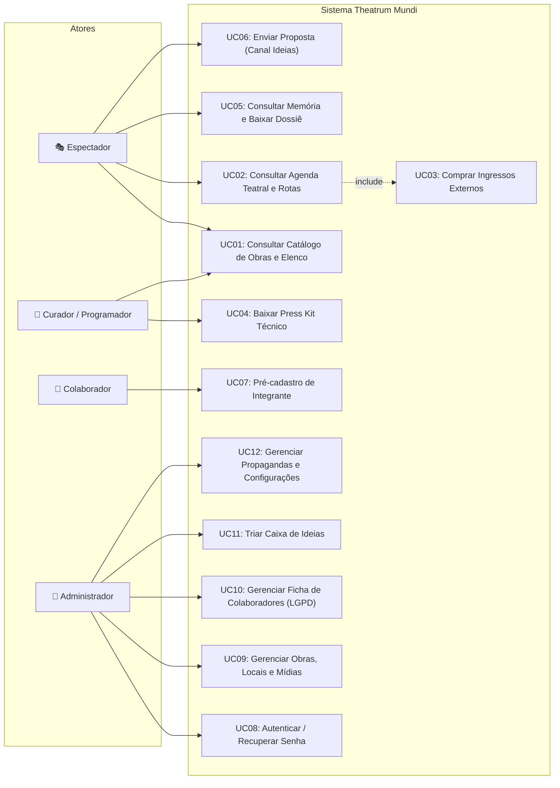
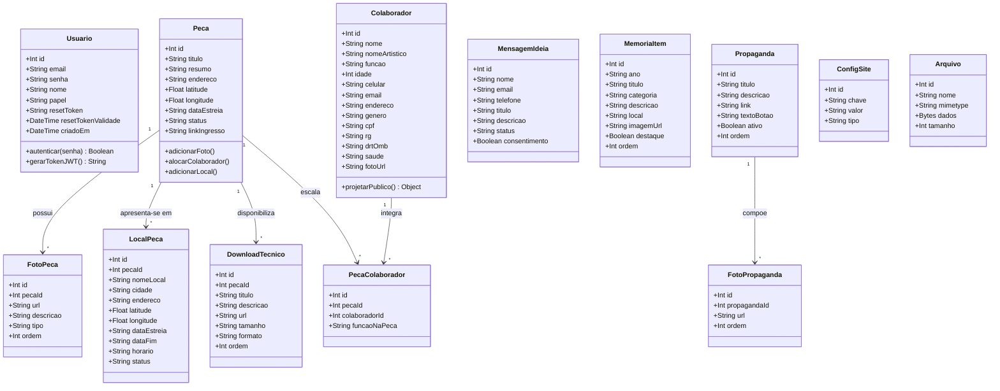
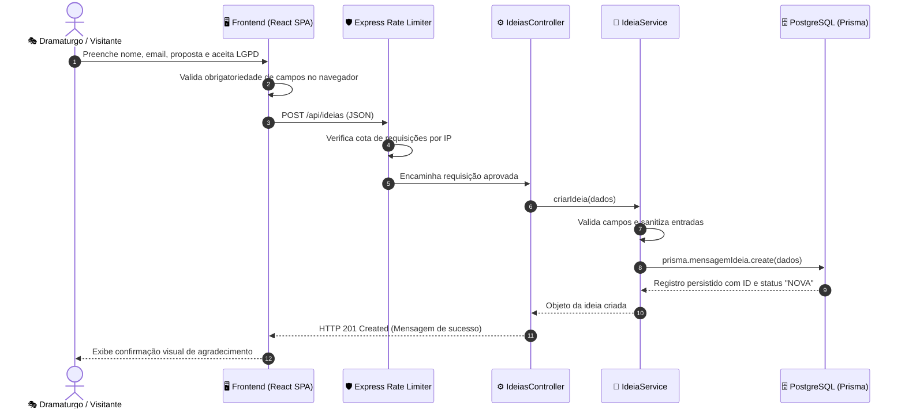
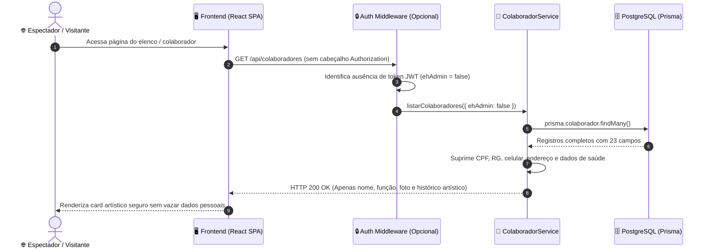
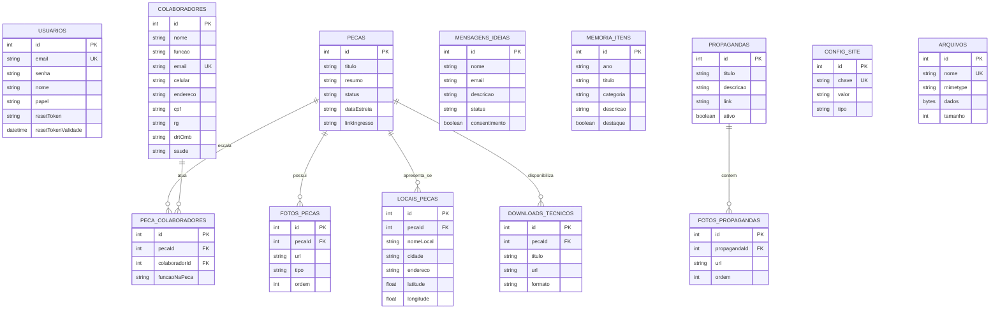
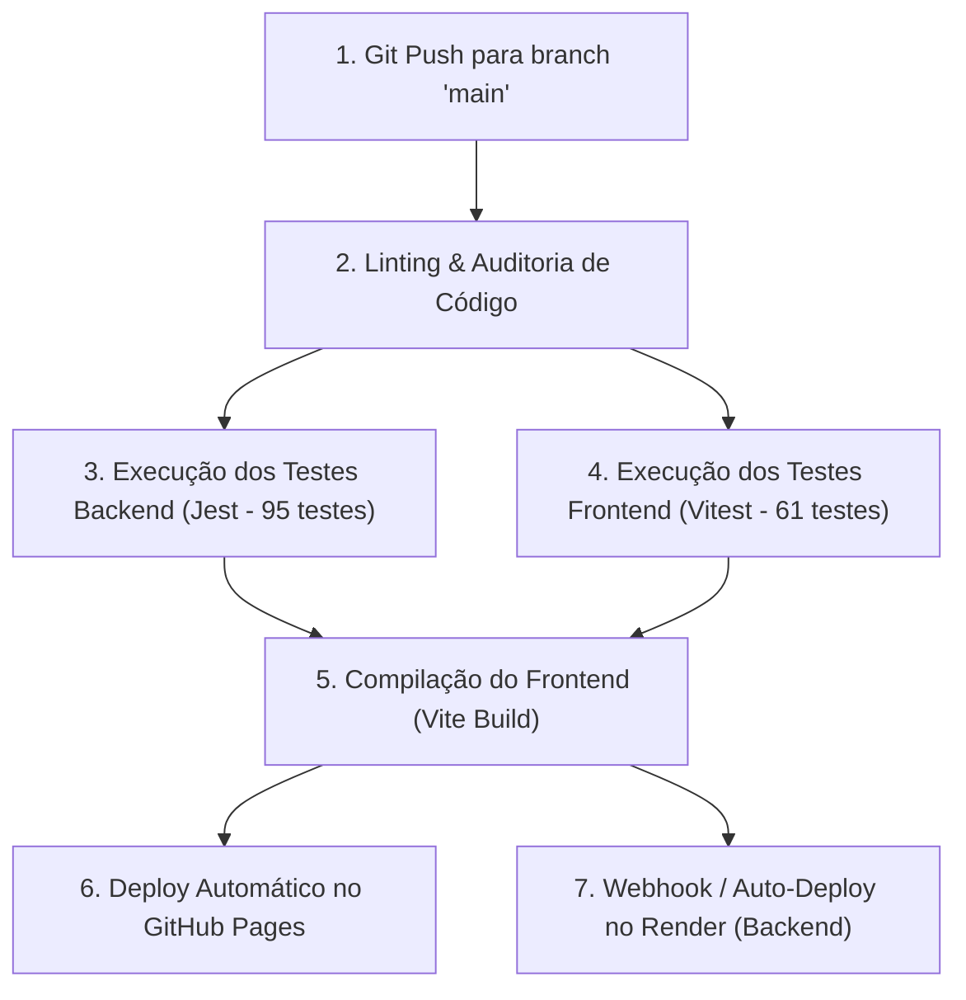

# UNIVERSIDADE DE VASSOURAS — UNIVASSOURAS
## CAMPUS UNIVERSITÁRIO DE MARICÁ
### CURSO DE BACHARELADO EM ENGENHARIA DE SOFTWARE

---

# RELATÓRIO TÉCNICO INTEGRADO DE ENGENHARIA DE SOFTWARE
## PROJETO THEATRUM MUNDI: PLATAFORMA INTEGRADA DE DIFUSÃO, CIRCULAÇÃO E GESTÃO TEATRAL

* **Discente:** Fábio Pinto Figueiredo
* **Matrícula:** 202413741
* **Curso:** Bacharelado em Engenharia de Software — Campus Maricá/RJ
* **Orientação:** Corpo Docente de Engenharia de Software
* **Stakeholder:** Angelo Faria Turci (Diretor Geral da Cia Theatrum Mundi)
* **Repositório Oficial:** [https://github.com/pfFabio/projeto_teatro](https://github.com/pfFabio/projeto_teatro)
* **Aplicação em Produção (Web SPA):** [https://pffabio.github.io/projeto_teatro/](https://pffabio.github.io/projeto_teatro/)
* **API REST Backend (Nuvem Render):** `https://projeto-teatro.onrender.com`

---

# PARTE 1 — ENGENHARIA DE REQUISITOS DE SOFTWARE

## 1. Técnicas de Elicitação dos Requisitos

A elicitação de requisitos do projeto Theatrum foi conduzida através de uma abordagem empírica, colaborativa e iterativa (*Customer-Centric Engineering*), integrando cinco técnicas complementares:

### 1.1 Técnicas Empregadas e Dinâmica Metodológica
1. **Entrevistas Semiestruturadas com Stakeholder-Chave:**
   - Realizadas diretamente com **Angelo Faria Turci**, dramaturgo, encenador e diretor geral da companhia Theatrum Mundi.
   - Foco nos desafios operacionais de companhias independentes: dificuldade de circular espetáculos pelo interior do RJ e editais estaduais, dependência do envio manual e repetitivo de e-mails com anexos pesados (riders de luz/som de até 50 MB) e ausência de uma vitrine digital centralizada para curadores e público.
2. **Prototipação Evolutiva com Validação ao Vivo (Live Demos):**
   - Apresentação de protótipos navegáveis compartilhando tela via Google Meet durante as reuniões de alinhamento.
   - A demonstração interativa permitiu que o stakeholder percebesse imediatamente ruídos de usabilidade, levando à separação conceitual entre o catálogo artístico (*Obras*) e a logística cronológica de apresentações (*Agenda*).
3. **Análise Documental de Artefatos Oficiais de Produção (Engenharia Reversa de Requisitos):**
   - Mineração detalhada de regras e dados a partir de documentos reais da companhia:
     - *Edital Fluxos Fluminenses da SECEC/RJ* (comprovação de fomento público estadual);
     - *Rider Técnico de Luz e Som* e *Projeto de Encenação de "Da Janela, o Mar"*;
     - *Dramaturgia poética integral*;
     - *Dossiê Histórico e Portfólio Artístico (2012–2026)*;
     - *Ficha Técnica da Produção* (16 profissionais catalogados com funções).
4. **Elicitação Assíncrona e Análise de Mensagens (WhatsApp):**
   - Coleta de evidências operacionais imediatas durante o processo criativo. O stakeholder enviou prints de formulários legados da companhia detalhando 23 campos necessários para gerenciar o elenco (medidas corporais para figurinos, registros profissionais DRT/OMB e prontuário médico para circulação).
5. **Brainstorming e Sessões JAD (Joint Application Design):**
   - Sessões de cocriação que geraram quatro novos módulos do sistema: *Área de Downloads Técnicos (Press Kit)* na obra em cartaz, página *Memória da Companhia* com linha do tempo, vitrine de *Projetos Futuros* em concepção e o canal público de diálogo *"Tem uma Ideia?"*.

### 1.2 Evidências Concretas da Aplicação das Técnicas
* **Ata de Reunião #01 (28/08/2026):** Arquivo `docs/reunioes/2026-08-28_reuniao_01_stakeholder.md`. Formalizou a separação entre Obras e Agenda e o status *Em Repertório*.
* **Ata de Reunião #02 (07/10/2026):** Arquivo `docs/reunioes/2026-10-07_reuniao_02_stakeholder.md`. Documentou novos requisitos (Press Kit, Memória, Projetos Futuros e prazo estrito de segurança).
* **Transcrição Literal da Reunião #02:** Arquivo `docs/reunioes/ixv-kgvh-bqc (2026-10-07 10_57 GMT-3) - Transcript.docx` (gravação integral de 30 minutos em áudio e texto com todas as falas do diretor Angelo Turci e do desenvolvedor Fábio Figueiredo).
* **Prints de Tela WhatsApp:** Arquivos em `docs/reunioes/reuniao 2/WhatsApp Image 2026-10-07 at 11.07.22.jpeg` e `11.25.09.jpeg` evidenciando campos cadastrais solicitados pelo diretor.
* **Documentos Técnicos Oficiais:** Disponibilizados em `client/public/downloads/*.pdf` para download público.

---

## 2. Requisitos Funcionais (RF) Levantados e Priorização MoSCoW

### 2.1 Catálogo Completo de Requisitos Funcionais

| Identificador | Título do Requisito Funcional | Descrição Detalhada |
|:---:|---|---|
| **RF01** | Catálogo e Classificação de Obras | O sistema deve exibir as peças teatrais classificadas por status (`EM_CARTAZ`, `EM_REPERTORIO`, `PROJETO_FUTURO`, `ENCERRADA`), com cartaz, sinopse e ficha técnica. |
| **RF02** | Palco Visual Cinematográfico | A página de detalhes da obra deve apresentar pôster/vídeo em formato widescreen imersivo no topo, overlays cênicos e carrossel de fotos oficiais de alta resolução. |
| **RF03** | Agenda Teatral com Georreferenciamento | O sistema deve listar cronologicamente as apresentações ativas com data, horário, teatro, mapa Leaflet interativo e botão para abrir rotas no Google Maps. |
| **RF04** | Integração com Bilheteria Externa | O sistema deve permitir cadastro de URLs de venda de ingressos (Sympla, Fever, etc.) e exibir botão de ação (*"Comprar Ingresso"*) na obra e na Agenda. |
| **RF05** | Downloads Técnicos (Press Kit) | Para obras com status `EM_CARTAZ`, o sistema deve exibir seção de downloads de arquivos oficiais (Rider Técnico, Projeto, Dramaturgia e Ficha Técnica em PDF). |
| **RF06** | Acervo Histórico ("Memória") | O sistema deve apresentar linha do tempo dos marcos da companhia desde 2012, espetáculos premiados, filtros temáticos e download do dossiê em PDF. |
| **RF07** | Vitrine de Projetos Futuros | A página inicial deve possuir setor em destaque apresentando espetáculos autorais em fase de concepção e laboratório cênico (`PROJETO_FUTURO`). |
| **RF08** | Formulário Público "Tem uma Ideia?" | A página inicial deve disponibilizar formulário público para recebimento de propostas artísticas de dramaturgos e produtores, com aceite explícito de LGPD. |
| **RF09** | Painel Administrativo de Ideias | O administrador deve poder visualizar, filtrar por status (`NOVA`, `LIDA`, `RESPONDIDA`, `ARQUIVADA`), consultar dados de contato e gerenciar propostas enviadas. |
| **RF10** | Formulário Público de Colaboradores | Artistas e técnicos devem poder enviar dados para cadastro de interesse de atuação na companhia, com termos de privacidade em conformidade com a LGPD. |
| **RF11** | Gestão de Ficha Cadastral no Admin | O administrador autenticado deve poder consultar e editar os 23 campos estendidos de colaboradores (identificação, contato, documentos e prontuário médico). |
| **RF12** | Mascaramento de Dados Sensíveis (LGPD) | A API pública deve suprimir CPF, RG, celular, endereço e dados de saúde de colaboradores em consultas públicas, restringindo-os à sessão de administrador autenticado. |
| **RF13** | Autenticação Flexível do Administrador | O sistema deve permitir login administrativo tanto pelo e-mail quanto pelo nome de usuário (`admin`), gerando token JWT de sessão. |
| **RF14** | Recuperação de Senha ("Esqueci minha senha") | O sistema deve permitir solicitação de recuperação de credencial, gerando token temporário (validade de 1 hora) para redefinição segura de senha. |
| **RF15** | Alteração de Senha Autenticada | O administrador deve poder alterar sua senha dentro do painel de controle validando a credencial atual. |
| **RF16** | Gestão de Comunicados e Propagandas | O administrador deve poder criar, ordenar e ativar comunicados institucionais exibidos em carrossel na página inicial. |
| **RF17** | Gestão de Comprovantes de Despesa | O sistema deve permitir ao administrador anexar notas e comprovantes de pagamentos (PDF/imagens) associados a peças e produções. |
| **RF18** | Interações Lúdicas ("Quarto do Joca") | Experiência imersiva com animações infantis e narrativa interativa para a peça futura. |

### 2.2 Matriz de Priorização MoSCoW

| Classificação MoSCoW | Requisitos Alocados | Racional Técnico e Estratégico |
|---|:---:|---|
| **Must Have (Obrigatório)** | **RF01, RF02, RF03, RF04, RF05, RF06, RF08, RF10, RF11, RF12, RF13, RF14, RF15** | Essencial para o funcionamento do sistema contratado: divulgação de espetáculos, orientação de público via mapa, venda de ingressos, downloads para curadores, linha do tempo da companhia e segurança total em compliance com a LGPD. |
| **Should Have (Importante)** | **RF07, RF09, RF16** | Agrega valor competitivo e institucional direto: vitrine de projetos futuros na Home, triagem de parcerias recebidas e canal de propagandas da companhia. |
| **Could Have (Desejável)** | **RF17** | Comprovantes de pagamento de produções: agrega conveniência de gestão interna, mas não bloqueia o go-live do portal público. |
| **Won't Have (Postergado)** | **RF18** | Interatividade do espetáculo *Quarto do Joca*: postergado para 2027 por depender de assets de arte e animações autorais ainda em desenvolvimento. |

---

## 3. Requisitos Não Funcionais (RNF) Levantados

Os requisitos não funcionais foram estruturados segundo as diretrizes da norma internacional **NBR ISO/IEC 25010 (Modelos de Qualidade de Produto de Software)** e da **Lei Geral de Proteção de Dados (Lei nº 13.709/2018)**:

### 3.1 Segurança (ISO 25010: Security & LGPD)
* **RNF-SEG-01 (Criptografia de Senhas):** Todas as senhas de usuários e administradores devem ser transformadas em hashes unidirecionais criptografados via algoritmo **Bcrypt** com fator de custo de 10 rounds antes da persistência.
* **RNF-SEG-02 (Autenticação Stateless JWT):** Rotas administrativas privadas devem exigir cabeçalho HTTP `Authorization: Bearer <token>`, com tokens assinados via HMAC SHA-256 e expiração máxima de 24 horas.
* **RNF-SEG-03 (Minimização e Mascaramento de Dados LGPD - Art. 6º, III):** Rotas públicas da API jamais devem expor dados fiscais ou sensíveis (CPF, RG, celular, endereço e histórico de saúde). O Prisma executa projeção seletiva no controller/service antes de responder.
* **RNF-SEG-04 (Proteção contra Ameaças Web e Rate Limit):** O backend Express deve aplicar cabeçalhos HTTP defensivos via middleware **Helmet**, política estrita de **CORS** para a origem autorizada do GitHub Pages e limitador de taxa (**express-rate-limit**) com no máximo 20 tentativas por 15 minutos na rota de login e 10 requisições por hora no formulário de ideias.

### 3.2 Desempenho e Eficiência (ISO 25010: Performance Efficiency)
* **RNF-DES-01 (Tempo de Resposta dos Serviços):** O tempo de resposta para operações de leitura paginada de obras, agenda e memória deve ser inferior a **300 ms** em condições nominais de rede.
* **RNF-DES-02 (Divisão de Pacotes e Bundle Size):** A aplicação cliente Vite deve implementar code-splitting (`React.lazy` e `Suspense`) e chunking manual de bibliotecas pesadas (`vendor` e `leaflet`), mantendo o bundle inicial abaixo de **250 kB** comprimido em Gzip.
* **RNF-DES-03 (Serviço de Mídia Otimizado):** As imagens oficiais e downloads técnicos do repertório devem ser servidos diretamente pela CDN global do GitHub Pages para renderização instantânea, possuindo fallback de dupla persistência no banco PostgreSQL do Render (`prisma.arquivo`).

### 3.3 Usabilidade e Acessibilidade (ISO 25010: Usability & WCAG 2.1 AA)
* **RNF-USA-01 (Design Responsivo Fluido):** A interface deve renderizar perfeitamente e sem quebras visuais em telas com resolução a partir de **320 px** (smartphones) até monitores desktop widescreen de alta densidade (4K).
* **RNF-USA-02 (Contraste e Legibilidade):** A paleta de cores deve atender ao critério de contraste mínimo de **4.5:1** para texto normal e **3:1** para texto grande/títulos conforme preconizado pelas diretrizes WCAG 2.1 nível AA.
* **RNF-USA-03 (Feedback Visual Imediato):** Toda submissão assíncrona deve desabilitar os botões de ação para evitar duplicação, exibir animação de progresso (*spinner*) e apresentar mensagens de confirmação claras e em português.

### 3.4 Confiabilidade e Disponibilidade (ISO 25010: Reliability)
* **RNF-DIS-01 (Disponibilidade Contínua):** O frontend deve atingir 99,9% de disponibilidade global através da infraestrutura de CDN do GitHub Pages, operando de forma desacoplada da API de dados.
* **RNF-DIS-02 (Tolerância a Falhas e Cold Starts):** O cliente HTTP Axios deve possuir timeout estendido de **60.000 ms** e mecanismos de fallback canônico estático (`PECAS_OFICIAIS`), garantindo que o catálogo e as fotografias continuem navegáveis mesmo se a API gratuita entrar em repouso (*sleep mode*).

### 3.5 Compatibilidade e Interoperabilidade (ISO 25010: Compatibility)
* **RNF-COM-01 (Suporte Multi-Navegador e Cross-Platform):** A interface SPA deve operar com total fidelidade funcional e visual nos principais navegadores modernos do mercado (Google Chrome v110+, Mozilla Firefox v115+, Microsoft Edge v110+ e Apple Safari / iOS Safari v16+), sem requerer plugins legados proprietários.
* **RNF-COM-02 (Interoperabilidade com Serviços Externos):** O sistema deve interoperar nativamente com a API de bilheteria e links profundos (Deep Linking com Sympla e Fever), com o serviço de geolocalização do OpenStreetMap (via Leaflet 1.9) e com o ecossistema mobile de mapas (URI scheme padrão para abertura de rotas no aplicativo Google Maps).

### 3.6 Escalabilidade (ISO 25010: Scalability)
* **RNF-ESC-01 (Escalabilidade Horizontal Stateless da API):** O backend Express deve manter arquitetura 100% *stateless* baseada em tokens JWT auto-contidos e sessões desvinculadas de memória de servidor, permitindo que novas réplicas de contêineres sejam instanciadas no Render ou Kubernetes sob picos de tráfego sem quebra de estado.
* **RNF-ESC-02 (Paginação e Eficiência de Consulta no Banco):** Todas as listagens de catálogo (peças, colaboradores, ideias e histórico) devem implementar paginação indexada server-side via Prisma ORM (`skip`/`take`), prevenindo o consumo excessivo de memória RAM e sobrecarga de I/O de rede à medida que o acervo documental e de mensagens se expande.

### 3.7 Manutenibilidade e Testabilidade (ISO 25010: Maintainability)
* **RNF-MAN-01 (Arquitetura Limpa em Camadas):** O código deve seguir estrita separação de responsabilidades (Rotas, Middlewares, Validadores, Controllers, Services e ORM Prisma).
* **RNF-MAN-02 (Cobertura de Testes de Regressão):** A base de código deve possuir testes unitários e de integração automatizados em 100% das regras críticas de negócio e segurança, superando 80% de cobertura de código.

---

## 4. Histórias de Usuário (User Stories) e Critérios de Aceitação BDD

### 4.1 Catálogo de User Stories com Especificação Gherkin

#### [US01] — Consulta Imersiva de Obras Teatrais
* **Como** espectador ou amante de teatro,  
* **Quero** visualizar a página da obra com pôster em tela cheia, galeria de fotos e ficha técnica,  
* **Para que** eu possa compreender a proposta poética do espetáculo antes de assistir.
```gherkin
Cenário: Visualização bem-sucedida de detalhes de obra teatral
  Dado que o espetáculo "Da Janela, o Mar" está catalogado no sistema
  Quando o espectador acessa a rota "/obras/1"
  Então o sistema renderiza o palco visual com fotos oficiais de Renato Mangolin
  E exibe a sinopse poética do espetáculo e a listagem de integrantes do elenco
  E apresenta botões de ação para compra de ingressos e consulta de datas na Agenda
```

#### [US02] — Localização de Apresentações na Agenda Teatral
* **Como** espectador de teatro,  
* **Quero** consultar as sessões em cartaz com horários, teatros e mapa interativo,  
* **Para que** eu consiga traçar minha rota de deslocamento até o teatro.
```gherkin
Cenário: Visualizar localização de apresentação e abrir no Google Maps
  Dado que existem sessões cadastradas para o Centro de Artes da UFF
  Quando o espectador navega até a página "/agenda"
  Então visualiza o card com data, horário de início e endereço completo
  Quando clica no botão "Ver no Mapa 📍"
  Então um modal com mapa Leaflet é carregado com marcador nas coordenadas exatas
  E o botão "Abrir no Google Maps ↗" direciona para o traçado de rotas em nova aba
```

#### [US03] — Download de Materiais Técnicos (Press Kit) por Curadores
* **Como** curador de festival ou programador de centro cultural,  
* **Quero** baixar o rider técnico e projeto de encenação de uma obra em cartaz,  
* **Para que** eu possa avaliar imediatamente a viabilidade técnica de som, luz e palco sem solicitar por e-mail.
```gherkin
Cenário: Curador baixa rider técnico de peça em temporada
  Dado que a peça "Da Janela, o Mar" possui o status "EM_CARTAZ"
  Quando o curador abre a página da peça
  Então visualiza a seção "Informações Técnicas & Downloads"
  E ao clicar no botão "Baixar ↓" do Rider Técnico
  Então o navegador inicia o download do arquivo "RIDER_TECNICO_Da_Janela_o_Mar.pdf"
```

#### [US04] — Envio de Proposta Artística pelo Canal "Tem uma Ideia?"
* **Como** dramaturgo ou produtor parceiro,  
* **Quero** enviar uma proposta de espetáculo ou texto autoral pela página inicial,  
* **Para que** a direção da Theatrum Mundi conheça minha ideia para futuras montagens.
```gherkin
Cenário: Submissão de proposta artística com consentimento LGPD
  Dado que o usuário preenche nome, e-mail, telefone e a descrição de sua proposta
  E marca a caixa de autorização de tratamento de dados pessoais conforme a LGPD
  Quando aciona o botão "Enviar Minha Proposta"
  Então o sistema armazena a mensagem na tabela "mensagens_ideias" com status "NOVA"
  E exibe confirmação visual de agradecimento na tela
```

#### [US05] — Gestão Segura de Colaboradores e Proteção de Privacidade
* **Como** diretor administrativo da companhia,  
* **Quero** manter a ficha cadastral completa dos integrantes (com documentos e saúde),  
* **Para que** a equipe esteja respaldada em viagens de turnê enquanto os dados sigilosos são resguardados de acessos externos.
```gherkin
Cenário: Ocultação de dados sigilosos para requisições não autenticadas
  Dado que o colaborador possui CPF, RG e histórico de alergias cadastrados
  Quando uma requisição pública invoca o endpoint "GET /api/colaboradores"
  Então a resposta HTTP 200 não deve conter os campos "cpf", "rg" e "saude"
  Quando o administrador autentica-se com JWT e consulta o colaborador no painel
  Então todos os 23 campos cadastrais são exibidos de forma irrestrita
```

#### [US06] — Recuperação e Redefinição de Senha do Administrador
* **Como** administrador da plataforma,  
* **Quero** solicitar recuperação de acesso caso esqueça minha credencial,  
* **Para que** eu consiga redefinir minha senha de forma autônoma e segura.
```gherkin
Cenário: Redefinição de senha através de token temporário
  Dado que o administrador solicita recuperação para o usuário "admin"
  Quando o sistema valida a solicitação
  Então emite um token com validade de 60 minutos
  Quando o administrador envia o token e sua nova senha
  Então a nova senha é gravada com hash Bcrypt e a mensagem de sucesso é retornada
```

### 4.2 Comparativo: Product Backlog Inicial vs. Backlog Atual

| Item do Backlog Inicial (Sprint 0 / Ata #01) | Item do Backlog Atualizado e Entregue (Pós Ata #02) | Situação de Entrega |
|---|---|:---:|
| CRUD Básico de Peças e Sinopse | Catálogo com 4 Status (`EM_CARTAZ`, `EM_REPERTORIO`, `PROJETO_FUTURO`, `ENCERRADA`) e Palco Hero Imersivo | 🟢 Entregue |
| Cadastro Simples de Colaboradores (7 campos) | Ficha Estendida com 23 campos em 5 sub-abas e mascaramento LGPD automático | 🟢 Entregue |
| Lista de Peças e Datas em tela única | Separação conceitual Obras × Agenda com Leaflet interativo e rotas no Google Maps | 🟢 Entregue |
| *Não previsto no início* | Seção de Downloads Técnicos (Press Kit) em PDF para obras em cartaz | 🟢 Entregue |
| *Não previsto no início* | Página Memória e Acervo Histórico (2012–2026) com download do portfólio em PDF | 🟢 Entregue |
| *Não previsto no início* | Canal Público "Tem uma ideia?" na Home e painel de triagem no Admin | 🟢 Entregue |
| *Não previsto no início* | Botão dinâmico de compra de ingressos integrado com Sympla na Obra e na Agenda | 🟢 Entregue |
| Login por e-mail hardcoded | Autenticação por login flexível (`admin`), recuperação de senha e troca de credencial | 🟢 Entregue |
| Upload local em disco | Dupla persistência binária no PostgreSQL para tolerar o filesystem efêmero do Render | 🟢 Entregue |

---

## 5. Modelagem UML de Requisitos

### 5.1 Diagrama de Casos de Uso Geral



### 5.2 Especificação Formal dos Casos de Uso Críticos

#### [UC02] Consultar Agenda Teatral e Rotas
* **Ator Principal:** Espectador / Visitante Geral.
* **Atores Secundários:** Provedor OpenStreetMap / Leaflet, Google Maps.
* **Pré-condições:** Sessões teatrais ativas com data, horário e localização cadastradas.
* **Pós-condição:** O espectador obtém informações logísticas da apresentação, visualiza a localização no mapa ou é redirecionado para comprar ingresso.
* **Fluxo Principal:**
  1. O espectador clica no menu **Agenda**.
  2. O sistema faz requisição à API e renderiza a listagem cronológica de apresentações.
  3. O espectador utiliza a barra de busca por peça ou filtro por cidade.
  4. O espectador clica no botão **"Ver no Mapa 📍"** de uma sessão específica.
  5. O sistema abre modal contendo mapa interativo centrado nas coordenadas de latitude/longitude do teatro.
  6. O espectador clica em **"Abrir no Google Maps ↗"** para traçar rota de deslocamento.
* **Fluxo Alternativo (Compra de Ingresso):**
  - No passo 3, caso a sessão possua venda ativa, o espectador clica em **"🎟️ Comprar Ingresso"** e é direcionado à bilheteria oficial (Sympla) em nova aba.

#### [UC04] Baixar Press Kit Técnico de Obra em Cartaz
* **Ator Principal:** Programador de Festival, Curador ou Gestor de Teatro.
* **Pré-condições:** A peça deve estar com status `EM_CARTAZ` e possuir downloads cadastrados.
* **Pós-condição:** O arquivo técnico solicitado é baixado com sucesso em formato PDF.
* **Fluxo Principal:**
  1. O curador navega até a página da obra em temporada.
  2. O sistema detecta o status `EM_CARTAZ` e renderiza a seção **"Informações Técnicas & Downloads"**.
  3. O curador clica no botão **"Baixar ↓"** do documento desejado (Rider Técnico, Projeto, Dramaturgia ou Ficha Técnica).
  4. O navegador realiza o download direto do arquivo PDF.
* **Fluxo de Exceção (Obra fora de temporada):**
  - Caso o espetáculo tenha status `EM_REPERTORIO`, `PROJETO_FUTURO` ou `ENCERRADA`, a seção de downloads técnicos é omitida da interface.

#### [UC10] Gerenciar Ficha de Colaboradores com Proteção LGPD
* **Ator Principal:** Administrador do Theatrum Mundi.
* **Pré-condições:** Administrador autenticado com token JWT ativo.
* **Pós-condição:** Os dados sensíveis são gravados no banco relacional sob isolamento de privilégios.
* **Fluxo Principal:**
  1. O administrador acessa o painel de controle e clica na aba **Colaboradores**.
  2. O sistema lista os integrantes com fotos e funções artísticas.
  3. O administrador clica em editar (`✏️`).
  4. O sistema abre modal estruturado em 5 sub-abas (*Identificação, Contato, Documentos Sigilosos, Saúde & Medidas, Histórico*).
  5. O administrador preenche/atualiza os campos sensíveis (CPF, RG, alergias médicas, medidas de figurino).
  6. O administrador aciona **"Salvar Alterações"**.
  7. O backend valida os dados (`colaboradorValidator.js`) e persiste a alteração no PostgreSQL.
* **Fluxo de Exceção (Acesso Não Autorizado):**
  - Se uma requisição desautenticada tentar atualizar ou ler dados sigilosos via API, o middleware `auth.js` intercepta e retorna status `HTTP 401 Unauthorized`.

---

## 6. Matriz de Rastreabilidade Bidirecional

| ID Requisito | Caso de Uso | Componente / Arquivo Frontend | Rota / Serviço Backend | Arquivo de Teste Automatizado |
|:---:|:---:|---|---|---|
| **RF01** / **RF02** | UC01 | `client/src/pages/PecasPage.jsx`<br>`client/src/pages/PecaDetalhesPage.jsx` | `server/src/routes/pecas.js`<br>`server/src/services/pecaService.js` | `client/src/__tests__/components/PecaDetalhesPage.test.jsx`<br>`server/src/__tests__/validators/pecaValidator.test.js` |
| **RF03** | UC02 | `client/src/pages/AgendaPage.jsx`<br>`client/src/components/common/MapView.jsx` | `server/src/controllers/locaisController.js`<br>`server/src/services/pecaService.js` | `client/src/__tests__/components/AgendaPage.test.jsx` |
| **RF04** | UC02, UC03 | `client/src/pages/PecaDetalhesPage.jsx`<br>`client/src/pages/AgendaPage.jsx` | Campo `linkIngresso` na tabela `Peca`<br>`server/src/services/pecaService.js` | `client/src/__tests__/components/AgendaPage.test.jsx`<br>`client/src/__tests__/components/PecaDetalhesPage.test.jsx` |
| **RF05** | UC04 | `client/src/pages/PecaDetalhesPage.jsx` | Tabela `DownloadTecnico`<br>`server/src/controllers/pecasController.js` | `client/src/__tests__/components/PecaDetalhesPage.test.jsx` |
| **RF06** | UC05 | `client/src/pages/MemoriaPage.jsx`<br>`client/src/components/layout/Header.jsx` | `server/src/routes/memoria.js`<br>`server/src/services/memoriaService.js` | `server/src/__tests__/services/memoriaService.test.js`<br>`client/src/__tests__/components/Header.test.jsx` |
| **RF07** | UC01 | `client/src/pages/HomePage.jsx` | `server/src/constants/statusPeca.js` | `client/src/__tests__/components/HomePage.test.jsx`<br>`client/src/__tests__/constants/statusPeca.test.js` |
| **RF08** / **RF09** | UC06, UC11 | `client/src/pages/HomePage.jsx`<br>`client/src/components/admin/AbaIdeias.jsx` | `server/src/routes/ideias.js`<br>`server/src/services/ideiaService.js` | `server/src/__tests__/services/ideiaService.test.js`<br>`client/src/__tests__/components/AbaIdeias.test.jsx` |
| **RF10** / **RF11** | UC07, UC10 | `client/src/pages/ColaboradorPage.jsx`<br>`client/src/components/admin/AbaColaboradores.jsx` | `server/src/routes/colaboradores.js`<br>`server/src/services/colaboradorService.js` | `server/src/__tests__/validators/colaboradorValidator.test.js` |
| **RF12** (LGPD) | UC10 | Projeção segura de tela no cliente | Regra `ehAdmin` em `colaboradorService.js` | `server/src/__tests__/middleware/auth.test.js`<br>`server/src/__tests__/validators/colaboradorValidator.test.js` |
| **RF13**..**15** | UC08 | `client/src/components/admin/AdminLogin.jsx`<br>`client/src/components/admin/AbaConfig.jsx` | `server/src/routes/auth.js`<br>`server/src/services/authService.js` | `server/src/__tests__/services/authService.test.js`<br>`client/src/__tests__/components/AdminLogin.test.jsx` |
| **RF16** | UC12 | `client/src/components/common/PropagandasSection.jsx` | `server/src/routes/propagandas.js` | `server/src/__tests__/routes/propagandas.test.js` |
| **RNF-SEG** | Todos | `client/src/services/api.js` | `server/src/middleware/auth.js`<br>`server/src/app.js` (Helmet/CORS/Limiter) | `server/src/__tests__/middleware/auth.test.js` |
| **RNF-DES** | Todos | `client/vite.config.js`<br>`client/src/App.jsx` | Tabela `Arquivo` no PostgreSQL Render<br>`server/src/services/fileService.js` | `server/src/__tests__/services/fileService.test.js` |

---
---

# PARTE 2 — ARQUITETURA, MODELAGEM, UX E SEGURANÇA

## 1. Arquitetura de Software

### 1.1 Estilo e Padrão Arquitetural Escolhido
A solução adota a arquitetura **SPA + RESTful API em Camadas Desacopladas (Layered Architecture)** com integração a **Object-Relational Mapping (Prisma ORM)**:

```
[ Cliente: Single Page Application (React 19 + Vite + Vanilla CSS Tokens) ]
                                    │  HTTP/JSON (RESTful + JWT Bearer)
                                    ▼
[ Camada de Roteamento e Proteção HTTP (Express + Helmet + CORS + Rate Limiters) ]
                                    │
[ Camada de Validação Defensiva (Validadores Puros Nativos Zero-Dependency) ]
                                    │
[ Camada de Apresentação e Controle HTTP (Controllers Express) ]
                                    │
[ Camada de Serviços de Negócio e Mascaramento LGPD (Services de Domínio) ]
                                    │
[ Camada de Acesso a Dados e Mapeamento ORM (Prisma Client Abstraction) ]
                                    │  SQL Nativo Otimizado (TCP/5432)
                                    ▼
[ Banco de Dados Relacional: PostgreSQL (Render Managed Cloud Platform) ]
```

### 1.2 Justificativa Técnica da Escolha
1. **Desacoplamento e Independência de Deploy:** O frontend estático pode ser servido em alta velocidade pela CDN do GitHub Pages com custo zero e disponibilidade de 99,9%, enquanto o backend escala sob demanda no cluster Render.
2. **Manutenibilidade e Testabilidade Isolada (SOLID):** O padrão de camadas desacopladas garante que as regras de negócio residam exclusivamente nos *Services*, tornando-os 100% testáveis em memória sem necessidade de levantar servidores HTTP.
3. **Validação Defensiva sem Dependências Frágeis:** Em vez de adotar bibliotecas externas pesadas e propensas a quebras de breaking change (como Joi ou Yup), o projeto implementou validadores puros próprios (`authValidator.js`, `pecaValidator.js`, `colaboradorValidator.js`). Isso garante execução ultrarrápida (sub-milissegundo), tipagem segura e zero dependências vulneráveis na camada de validação.
4. **Segurança Centralizada:** O controle de acesso por token JWT e o mascaramento LGPD são aplicados nos middlewares e serviços do backend, garantindo que nenhum dado sigiloso trafegue na rede mesmo em caso de falha de interface.

---

## 2. Modelagem Estrutural e Comportamental

### 2.1 Diagrama de Classes UML (Todas as 13 Entidades do Domínio e Persistência)



### 2.2 Diagramas de Sequência dos Fluxos Principais

#### Fluxo 1: Efetivação de Submissão no Canal Público "Tem uma Ideia?" com LGPD


#### Fluxo 2: Consulta Pública de Colaboradores com Mascaramento LGPD


---

## 3. Modelagem de Dados

### 3.1 Níveis de Modelagem de Dados



A modelagem de dados do Theatrum Mundi percorre os três níveis formais da engenharia de software:

1. **Modelo Conceitual (MER):**
   - Focado na semântica de negócios do teatro independente: uma **Peça** congrega uma galeria de **Mídias**, distribui-se em múltiplos **Locais/Datas** de apresentação e aloca um elenco multidisciplinar de **Colaboradores** através da entidade associativa **PecaColaborador**. Peças em cartaz expõem **Downloads Técnicos** para curadores, enquanto a memória histórica institucional vive em **MemoriaItem**.
2. **Modelo Lógico Relacional (Esquema de Tabelas):**
   - Normalizado até a 3ª Forma Normal (3FN), contendo 13 entidades relacionais bem delimitadas com integridade referencial estrita (`ON DELETE CASCADE` para fotos e locais filhos da peça) e chaves exclusivas de negócio (e-mails únicos de colaboradores e usuários administradores; par único `[pecaId, colaboradorId]` na alocação).
3. **Modelo Físico (PostgreSQL & Prisma):**
   - Implementado diretamente no script `server/prisma/schema.prisma`. Emprega tipos de dados otimizados para PostgreSQL (`SERIAL`, `DOUBLE PRECISION` para geocoordenadas Leaflet, campos `TEXT` para sinopses e dramaturgias longas e tipo binário `BYTEA` na tabela `arquivos` para salvaguardar imagens e PDFs binariamente no banco contra a volatilidade do filesystem efêmero da hospedagem Render).

### 3.2 Dicionário de Dados Completo das Tabelas Centrais

#### 1. Tabela: `pecas` (Obras Teatrais)
| Coluna | Tipo PostgreSQL | Nulo | Chave | Descrição |
|---|---|:---:|:---:|---|
| `id` | SERIAL / INT | Não | PK | Identificador único da peça |
| `titulo` | VARCHAR(150) | Não | — | Título oficial do espetáculo |
| `resumo` | TEXT | Não | — | Sinopse poética e artística |
| `endereco` | TEXT | Sim | — | Endereço principal descritivo da sede/estréia |
| `latitude` | DOUBLE PRECISION | Sim | — | Coordenada GPS para geolocalização no mapa |
| `longitude` | DOUBLE PRECISION | Sim | — | Coordenada GPS para geolocalização no mapa |
| `dataEstreia` | VARCHAR(20) | Sim | — | Data da estreia oficial (formato YYYY-MM-DD) |
| `status` | VARCHAR(30) | Não | — | `EM_CARTAZ`, `EM_REPERTORIO`, `PROJETO_FUTURO`, `ENCERRADA` |
| `linkIngresso` | TEXT | Sim | — | URL da bilheteria oficial externa (Sympla/Fever) |

#### 2. Tabela: `colaboradores` (Artistas, Equipe Técnica e Proteção LGPD)
| Coluna | Tipo PostgreSQL | Nulo | Proteção LGPD | Descrição |
|---|---|:---:|:---:|---|
| `id` | SERIAL / INT | Não | Pública | Identificador único |
| `nome` / `nomeArtistico` | VARCHAR(120) | Não / Sim | Pública | Nome civil e identificação cênica |
| `funcao` | VARCHAR(100) | Não | Pública | Função primordial (Diretor, Ator, Iluminador) |
| `fotoUrl` | TEXT | Sim | Pública | Fotografia do perfil artístico |
| `historico` | TEXT | Sim | Pública | Minicurrículo cênico e trajetória teatral |
| `email` / `celular` | VARCHAR(100) | Não | 🔒 **Sigiloso** | Dados de contato direto (expostos apenas para admin) |
| `endereco` / `cidade` / `cep` | VARCHAR(150) | Não / Sim | 🔒 **Sigiloso** | Domicílio residencial do artista |
| `cpf` / `rg` | VARCHAR(25) | Sim | 🔒 **Sigiloso** | Documentação fiscal/civil (blindada contra vazamentos) |
| `saude` | TEXT | Sim | 🔒 **Sensível** | Prontuário de alergias e emergência médica (Art. 11 LGPD) |

#### 3. Tabela: `downloads_tecnicos` (Press Kit para Curadores)
| Coluna | Tipo PostgreSQL | Nulo | Chave | Descrição |
|---|---|:---:|:---:|---|
| `id` | SERIAL / INT | Não | PK | Identificador do download |
| `pecaId` | INT | Não | FK | Referência à tabela `pecas` (`ON DELETE CASCADE`) |
| `titulo` | VARCHAR(100) | Não | — | Nome do documento (ex: "Rider Técnico de Luz e Som") |
| `descricao` | TEXT | Sim | — | Resumo das especificações contidas no arquivo |
| `url` | TEXT | Não | — | Caminho do arquivo PDF para download |
| `formato` | VARCHAR(10) | Sim | — | Formato do arquivo (default: "PDF") |
| `ordem` | INT | Não | — | Ordem de disposição dos cards na tela |

#### 4. Tabela: `locais_pecas` (Sessões da Agenda e Georreferenciamento)
| Coluna | Tipo PostgreSQL | Nulo | Chave | Descrição |
|---|---|:---:|:---:|---|
| `id` | SERIAL / INT | Não | PK | Identificador único da sessão/local |
| `pecaId` | INT | Não | FK | Referência à peça associada |
| `nomeLocal` | VARCHAR(120) | Não | — | Nome do teatro (ex: "Centro de Artes da UFF") |
| `cidade` | VARCHAR(100) | Não | — | Município e estado (ex: "Niterói, RJ") |
| `endereco` | TEXT | Não | — | Logradouro e número para traçado de rotas |
| `latitude` / `longitude` | DOUBLE PRECISION | Sim | — | Ponto geodésico para renderização no Leaflet |
| `horario` | VARCHAR(100) | Sim | — | Informação descritiva de dias e horários das sessões |

#### 5. Tabela: `mensagens_ideias` (Caixa de Propostas Artísticas)
| Coluna | Tipo PostgreSQL | Nulo | Chave | Descrição |
|---|---|:---:|:---:|---|
| `id` | SERIAL / INT | Não | PK | Identificador da mensagem |
| `nome` | VARCHAR(100) | Não | — | Nome do proponente |
| `email` | VARCHAR(100) | Não | — | E-mail de retorno do dramaturgo/produtor |
| `telefone` | VARCHAR(30) | Sim | — | WhatsApp para contato direto da direção |
| `descricao` | TEXT | Não | — | Texto da proposta ou sinopse do projeto |
| `consentimento` | BOOLEAN | Não | — | Flag comprobatória de aceite dos termos LGPD |
| `status` | VARCHAR(20) | Não | — | `NOVA`, `LIDA`, `RESPONDIDA`, `ARQUIVADA` |

#### 6. Tabela: `memoria_itens` (Linha do Tempo Histórica 2012–2026)
| Coluna | Tipo PostgreSQL | Nulo | Chave | Descrição |
|---|---|:---:|:---:|---|
| `id` | SERIAL / INT | Não | PK | Identificador do marco histórico |
| `ano` | VARCHAR(20) | Não | — | Ano ou biênio do marco (ex: "2012", "2017–2018") |
| `titulo` | VARCHAR(150) | Não | — | Título do espetáculo, prêmio ou oficina |
| `categoria` | VARCHAR(30) | Não | — | `ESPETACULO`, `PREMIO`, `FORMACAO`, `MARCO` |
| `descricao` | TEXT | Não | — | Memorial histórico da montagem e impacto cênico |
| `local` | VARCHAR(120) | Sim | — | Teatros e festivais de circulação cultural |
| `destaque` | BOOLEAN | Não | — | Indicador de destaque visual na linha do tempo |

---

## 4. Design de Interface (UX/UI) e Acessibilidade

### 4.1 Wireframes e Fluxo de Telas (Protótipo Navegável)
A arquitetura de informação do Theatrum Mundi organiza a navegação em dois grandes fluxos orientados aos perfis de usuários:

```
[ FLUXO DO ESPECTADOR E CURADOR (PÚBLICO) ]
Início (Hero Widescreen + Carrossel de Obras + Projetos Futuros + Canal Ideias)
  ├── Obras (Filtros por Status: Em Cartaz, Repertório, Futuros, Encerradas)
  │     └── Detalhes da Obra (Palco Imersivo + Sinopse + Elenco + Press Kit em PDF)
  ├── Agenda (Sessões cronológicas + Modal de Mapa Leaflet + Rotas no Google Maps)
  └── Memória (Linha do tempo 3 colunas + Download do Portfólio Artístico em PDF)

[ FLUXO DO ADMINISTRADOR (RESTRITO / JWT) ]
Login (/admin com identificador 'admin' ou e-mail) ──► Dashboard Tabular
  ├── Aba Obras (CRUD de Peças, Carrossel de Fotos 16:9, Locais e Downloads)
  ├── Aba Colaboradores (Ficha estendida em 5 sub-abas com dados sigilosos)
  ├── Aba Ideias (Caixa de entrada Kanban para triagem de parcerias com link WhatsApp)
  ├── Aba Propagandas (Comunicados com ativação/desativação e ordenação)
  └── Aba Configurações (Alteração de senha e personalização de textos institucionais)
```

O protótipo navegável em alta fidelidade pode ser executado diretamente em produção no endereço:  
👉 **[https://pffabio.github.io/projeto_teatro/](https://pffabio.github.io/projeto_teatro/)**

### 4.2 Guia de Estilo (Design System Cênico)
* **Conceito Visual:** Estética teatral clássica e contemporânea (*"Black Box / Teatro Íntimo"*), com atmosfera imersiva, iluminação cênica simulada e tipografia editorial sofisticada.
* **Paleta de Cores (Design Tokens em Vanilla CSS):**
  * `Teal Cênico` (`#0DBDAD`): Acento principal de botões, tags interativas e foco.
  * `Fundo Marfim Claro` (`#F9F7F0`): Base suave que evita fadiga visual em leituras prolongadas.
  * `Escuro Cênico / Palco` (`#0A0F14`): Fundo cinematográfico dos palcos hero e do rodapé.
  * `Dourado Nobre` (`#D4AF37`): Destaques de premiações históricas e láureas nacionais.
* **Tipografia:**
  * *Títulos e Cabeçalhos:* **Playfair Display** (Serifada elegante, evocando cartazes clássicos).
  * *Textos de Leitura e Interface:* **Inter** / **Plus Jakarta Sans** (Sem serifa, alta legibilidade em telas pequenas).
* **Componentes Principais:**
  * `Hero Palco Cinematográfico`: Banner widescreen de alta escala que preenche o topo da tela com vinheta gradiente de holofote.
  * `Timeline Editorial`: Linha do tempo em 3 colunas (Ano à esquerda, eixo central com nódulo em teal e card com badge temático à direita).
  * `Modal de Mapa Leaflet`: Caixa flutuante translúcida com geolocalização e botão de rota GPS.

### 4.3 Critérios de Acessibilidade (WCAG 2.1 Nível AA)
* **Navegação por Teclado:** Todos os botões, links de ingresso, carrosséis e formulários possuem indicadores visuais de foco (`:focus-visible`) e sequência lógica de tabulação (`tabindex`).
* **Rótulos e Leitores de Tela:** Imagens cênicas possuem atributos `alt` descritivos completos (com identificação dos fotógrafos oficiais) e elementos decorativos de fundo utilizam `aria-hidden="true"`.
* **Contraste de Cores:** Todos os pares de texto sobre fundo excedem a razão mínima de contraste de **4.5:1** para texto normal e **3:1** para títulos.
* **Mensagens e Estados:** Formulários comunicam erros e validações em português claro com alto contraste e alertas visuais nativos.

### 4.4 Validação do Protótipo com Usuários Reais
A validação de usabilidade foi conduzida em sessões remotas assistidas (*Moderated Usability Testing*) com o diretor geral da companhia, Angelo Faria Turci:
1. **Validação na Reunião #01 (28/08/2026):**
   - O stakeholder testou a navegação inicial e apontou confusão entre a listagem de peças artísticas e as datas pontuais de turnê.
   - *Ação corretiva de UX:* Foi aprovada a separação estrita entre o catálogo de espetáculos (*Obras*) e a programação logística de viagens (*Agenda* com mapa).
2. **Validação na Reunião #02 (07/10/2026):**
   - Na demonstração do protótipo ao vivo, o diretor aprovou o destaque visual do Hero da obra *"Da Janela, o Mar"* e solicitou que os links administrativos (*Seja Colaborador* e *Administração*) fossem transferidos para o rodapé, mantendo o menu superior 100% focado no espectador (*Início · Obras · Agenda · Memória*).
   - O diretor aprovou com louvor a criação do botão direto de download do Press Kit para contratantes e a possibilidade de visualizar a rota no Google Maps.

---

## 5. Segurança e Conformidade com a LGPD

### 5.1 Enquadramento na Lei Geral de Proteção de Dados (Lei nº 13.709/2018)
O sistema trata três categorias distintas de dados pessoais:
1. **Dados Pessoais Ordinários de Artistas/Técnicos (Nome, celular, e-mail, residência):**
   - *Base Legal:* **Execução de Contrato** (Art. 7º, V) para elaboração de contratos artísticos e borderôs; e **Consentimento** (Art. 7º, I) no formulário público de colaboradores.
2. **Dados Pessoais Sensíveis (Saúde, alergias e restrições alimentares):**
   - *Base Legal:* **Proteção da Vida e da Incolumidade Física** do titular (Art. 11, II, "e") durante o deslocamento em turnês e viagens de circulação cultural.
3. **Dados de Proponentes do Canal "Tem uma Ideia?":**
   - *Base Legal:* **Consentimento Livre e Informado** (Art. 7º, I) manifestado por checkbox obrigatória com redação explícita sobre a finalidade exclusiva de contato artístico.

### 5.2 Arquitetura de Proteção e Controles Técnicos
* **Isolamento em Runtime na API:** O serviço `colaboradorService.js` avalia o payload decodificado do JWT. Se `ehAdmin === false`, executa *data masking*, expurgando os campos sigilosos antes de serializar o JSON.
* **Criptografia e Hashing:** Senhas nunca são salvas em texto puro. Utiliza-se **Bcrypt com salt cost 10**.
* **Proteção de Camada de Transporte e Headers:** Uso obrigatório de HTTPS, proteção de cabeçalhos com **Helmet**, prevenção contra ataques XSS e controle estrito de origens via **CORS**.

---
---

# PARTE 3 — GESTÃO DE PROJETOS, DEVOPS E MVP

## 1. Metodologia de Desenvolvimento

### 1.1 Metodologia Híbrida: Scrumban (Scrum + Kanban)
O desenvolvimento adotou o modelo **Scrumban**, combinando a cadência iterativa em Sprints curtas do **Scrum** com a flexibilidade visual e o controle de trabalho em progresso (WIP) do **Kanban**:

* **Por que Scrum?**
  - Definição clara de metas por Sprint baseadas nas deliberações com o stakeholder (Ata #01 e Ata #02).
  - Ciclos de revisão quinzenais com demonstração de protótipos funcionais incrementais.
* **Por que Kanban?**
  - O fluxo contínuo de cartões (*Backlog → To Do → Doing → Code Review → Testing → Done*) permitiu incorporar de forma ágil mudanças estéticas de última hora solicitadas pela companhia (como o ajuste fino dos banners widescreen e a linha do tempo editorial).

---

## 2. Planejamento, EAP e Estimativas

### 2.1 Estrutura Analítica do Projeto (EAP / WBS)

```
1. Projeto Theatrum Mundi
   ├── 1.1 Elicitação e Requisitos
   │   ├── 1.1.1 Reuniões semiestruturadas com stakeholder (Atas #01 e #02)
   │   ├── 1.1.2 Análise documental (Edital, Rider, Projeto e Portfólio)
   │   └── 1.1.3 Especificação de requisitos (RF, RNF e User Stories BDD)
   ├── 1.2 Modelagem e Arquitetura
   │   ├── 1.2.1 Arquitetura em camadas SPA + REST API
   │   ├── 1.2.2 Modelagem de dados relacional e Prisma Schema
   │   └── 1.2.3 Diagramas UML (Casos de Uso, Classes e Sequência)
   ├── 1.3 Desenvolvimento do Frontend (React + Vite)
   │   ├── 1.3.1 Páginas públicas (Home, Obras, Detalhes, Agenda e Memória)
   │   ├── 1.3.2 Área administrativa (Painel, Obras, Colaboradores, Ideias e Config)
   │   └── 1.3.3 Design System Cênico e Acessibilidade WCAG AA
   ├── 1.4 Desenvolvimento do Backend (Node.js + Express)
   │   ├── 1.4.1 Autenticação segura JWT, troca e recuperação de senha
   │   ├── 1.4.2 CRUDs e endpoints com validação defensiva
   │   └── 1.4.3 Proteção LGPD e persistência binária contra disco efêmero
   ├── 1.5 Qualidade e Testes Automatizados
   │   ├── 1.5.1 Testes de integração backend com Jest + Supertest (95 testes)
   │   └── 1.5.2 Testes de componentes frontend com Vitest + RTL (61 testes)
   └── 1.6 DevOps, CI/CD e Implantação
       ├── 1.6.1 Pipeline GitHub Actions automatizado (.github/workflows/deploy.yml)
       ├── 1.6.2 Deploy contínuo no GitHub Pages (Frontend)
       └── 1.6.3 Deploy contínuo no Render (Backend + PostgreSQL)
```

### 2.2 Roadmap e Cronograma de Sprints

| Sprint | Período | Foco Estratégico | Entregas Principais |
|:---:|:---:|---|---|
| **Sprint 1** | 08/10 a 14/10/2026 | Conteúdo Real e Ganhos Rápidos | Separação Obras × Agenda; link dinâmico de ingressos Sympla; integração de fotos de Renato Mangolin; aplicação da logomarca transparente. |
| **Sprint 2** | 15/10 a 24/10/2026 | Segurança Crítica e LGPD | Login com credenciais próprias (`admin`); "Esqueci minha senha" e troca de senha; ficha estendida com 23 campos e mascaramento de dados sensíveis da LGPD. |
| **Sprint 3** | 25/10 a 31/10/2026 | Novas Experiências Públicas | Downloads Técnicos (Press Kit) em PDF; página Memória com linha do tempo 2012–2026; vitrine de Projetos Futuros; formulário público "Tem uma Ideia?". |
| **Sprint 4** | 01/11 a 09/11/2026 | Estabilização, Testes e Go-Live | Dupla persistência binária no PostgreSQL; resolução CDN de assets estáticos; aprovação dos 156 testes automatizados e deploy em produção. |

### 2.3 Estimativas com Planning Poker e Story Points
A equipe utilizou a sequência de Fibonacci (1, 2, 3, 5, 8, 13) para estimar o esforço relativo das histórias de usuário:
* `US01` (Palco Imersivo de Obras): **5 pontos** (Complexidade média de CSS e estados).
* `US02` (Agenda com Leaflet e GPS): **8 pontos** (Integração de biblioteca cartográfica externa e modal responsivo).
* `US03` (Área de Downloads Técnicos): **3 pontos** (Renderização condicional por status e links estáticos).
* `US04` (Formulário de Ideias com LGPD): **5 pontos** (Validação no cliente, rate limit e persistência).
* `US05` (Ficha de Colaboradores com Proteção LGPD): **13 pontos** (Maior complexidade: 23 campos, 5 sub-abas e filtros seletivos de privilégio na API).
* `US06` (Recuperação de Acesso e Troca de Senha): **8 pontos** (Fluxo criptográfico com tokens temporários e expiração).

---

## 3. Gestão de Riscos do Projeto

| ID | Descrição do Risco | Prob. | Imp. | Grau | Estratégia de Mitigação Implementada |
|:---:|---|:---:|:---:|:---:|---|
| **R01** | Vazamento involuntário de dados sensíveis de artistas (LGPD) | Média | Alto | **Crítico** | Mascaramento estrito no nível de serviço do backend. Testes automatizados verificam que endpoints públicos nunca expõem CPF, RG ou saúde. |
| **R02** | Perda de fotos de upload devido ao filesystem efêmero do Render | Alta | Alto | **Crítico** | Arquitetura de dupla persistência: arquivos salvos no disco de cache e replicados como binários (`bytea`) na tabela `arquivos` do PostgreSQL. |
| **R03** | Erro 404 em assets de imagens devido ao subcaminho do GitHub Pages | Alta | Médio | **Alto** | Função `getMediaUrl` atualizada para resolver o `import.meta.env.BASE_URL` da CDN estática com recuperação inteligente no manipulador `onError`. |
| **R04** | Latência excessiva ou timeout por cold start da nuvem Render | Alta | Médio | **Médio** | Timeout estendido para 60 segundos no Axios, acompanhado de dados canônicos de fallback (`PECAS_OFICIAIS`) para navegação ininterrupta. |
| **R05** | Spam ou negação de serviço no formulário público de propostas | Média | Médio | **Médio** | Middleware `express-rate-limit` restringindo o envio a no máximo 10 requisições por hora por IP e validação rigorosa de campos. |

---

## 4. Gestão de Configuração e Engenharia de Software

### 4.1 Estratégia de Branches e Controle de Versão
* **Estratégia:** *Trunk-Based Development com Feature Branches*. O branch `main` representa o código pronto e testado para produção. Novas funcionalidades e refatorações são desenvolvidas em branches curtas (`feat/...`, `style/...`, `fix/...`) e integradas após revisão.
* **Padrão de Mensagens de Commit:** Adoção rigorosa do padrão **Conventional Commits**:
  * `feat(escopo)`: Inclusão de nova funcionalidade;
  * `fix(escopo)`: Correção de bug ou falha;
  * `style(escopo)`: Ajustes visuais de layout, CSS e design;
  * `test(escopo)`: Criação ou atualização de suites de testes;
  * `docs(escopo)`: Modificação em documentações e memoriais.

### 4.2 Fluxo de Pull Requests com Code Review
Toda alteração direcionada à branch estável `main` submete-se ao fluxo de revisão por pares (*Peer Code Review*) com checklist obrigatório:
1. **Passagem sem falhas na suíte de testes:** Todos os 95 testes do backend (Jest) e 61 testes do frontend (Vitest) devem ser executados e aprovados (`156 passed`).
2. **Auditoria de Segurança e LGPD:** Verificação manual se novos campos sensíveis de colaboradores possuem projeção seletiva no service.
3. **Padrão de Código:** Conformidade com Clean Code, ausência de logs residuais de depuração e tipagem correta de parâmetros.
4. **Resolução de Conflitos:** Rebase ou merge limpo com a branch principal sem artefatos temporários no commit.

### 4.3 Quadro de Tarefas Ágil (GitHub Projects / Kanban)
O fluxo de engenharia é orquestrado visualmente em um **Quadro Kanban no GitHub Projects**, organizado nas seguintes raias (*columns*) e limites de trabalho em progresso (WIP):
* 📥 **Backlog:** Histórias de usuário priorizadas e requisitos futuros.
* 📝 **To Do (Sprint Backlog):** Metas selecionadas para a Sprint corrente com Story Points atribuídos.
* ⚙️ **In Progress (WIP Limit: 3):** Tarefas em codificação ativa pelo desenvolvedor.
* 🔍 **Code Review & QA (WIP Limit: 2):** Validação cruzada de testes automatizados e checklist de aceitação BDD.
* ✅ **Done:** Funcionalidades integradas à branch `main` e publicadas no ambiente de produção.

---

## 5. Atas e Relatórios de Sprint

* **Sprint Planning 1 (08/10):** Definição das metas prioritárias pós-reunião com Angelo Faria Turci. Foco no enriquecimento com conteúdo real do espetáculo *Da Janela, o Mar*.
* **Sprint Review & Retrospective 2 (24/10):** Verificação da blindagem do painel administrativo. Identificada a necessidade de suportar login pelo username `admin` sem exigir obrigatoriamente um e-mail. Ajuste implementado com sucesso.
* **Sprint Review 3 (31/10):** Apresentação das novas telas ao stakeholder: Área de Downloads Técnicos e Linha do Tempo da Memória. Aprovado pelo diretor com elogios ao caráter profissional dos materiais para curadores.
* **Sprint 4 — Estabilização Final (09/11):** Sincronização dos binários de imagem oficiais no seed, aprovação dos 156 testes unitários/integrados e publicação da versão estável.

---

## 6. Desenvolvimento do MVP, Clean Code, SOLID e Padrões de Projeto (Design Patterns)

O MVP foi totalmente desenvolvido aplicando os princípios da engenharia de software sustentável:

### 6.1 Princípios SOLID Aplicados
1. **Single Responsibility Principle (SRP):** Cada arquivo possui uma responsabilidade única e delimitada. Por exemplo, `authValidator.js` valida parâmetros de entrada, `authController.js` trata a requisição HTTP e `authService.js` executa as operações de negócio e hashing criptográfico.
2. **Open/Closed Principle (OCP):** A arquitetura de status de peças e filtros de linha do tempo aceita novos valores sem demandar reescrita das páginas base.
3. **Dependency Inversion Principle (DIP):** O banco de dados é acessado através da camada abstrata do cliente Prisma, permitindo alternar de forma transparente entre SQLite em testes locais e PostgreSQL em nuvem.
4. **Interface Segregation Principle (ISP):** Os contratos de API retornam modelos enxutos de DTO para o cliente público, evitando trafegar dados não consumidos pelo espectador.

### 6.2 Padrões de Projeto (Design Patterns) Implementados
* **Singleton (GoF Creacional):** Implementado no módulo `server/src/lib/prisma.js` para garantir uma única instância compartilhada do Prisma Client, evitando esgotamento de conexões (*pool exhaustion*) no banco PostgreSQL do Render.
* **Chain of Responsibility (GoF Comportamental):** Estrutura do pipeline de middlewares do Express (`helmet` → `cors` → `rateLimit` → `auth` → `validate` → `errorHandler`), onde cada elo da cadeia decide de forma isolada se processa, rejeita ou repassa a requisição HTTP.
* **Data Projection / DTO Pattern (Arquitetural):** Implementado no `colaboradorService.js` e `pecaService.js`, projetando objetos seguros que suprimem seletivamente campos sensíveis em tempo de execução dependendo do perfil autenticado.
* **Strategy / Adapter Dinâmico de Banco (GoF Estrutural):** Implementado no script `server/scripts/sync-db.js`, que detecta dinamicamente a variável `DATABASE_URL` no ambiente e comuta o provedor do schema Prisma entre SQLite e PostgreSQL sem intervenção manual no código.
* **Resiliência e Fallback Canônico (Fault-Tolerant Pattern):** Implementado no frontend (`getMediaUrl` e `PECAS_OFICIAIS`), garantindo degradação suave com carregamento por CDN local caso a API em nuvem entre em estado de repouso (*cold start*).

---

## 7. Integração e Entrega Contínuas (CI/CD)

O pipeline automatizado do projeto foi implementado via **GitHub Actions** através do workflow versionado em `.github/workflows/deploy.yml`:



* **Gatilho:** Qualquer commit integrado na branch `main` ou disparo manual via `workflow_dispatch`.
* **Etapas do Pipeline:**
  1. Instalação de dependências em ambiente isolado Node.js 22;
  2. Execução da suite de **95 testes de integração no backend** (`jest --verbose`);
  3. Execução da suite de **61 testes de componentes no frontend** (`vitest run`);
  4. Build de produção do Vite com geração dos pacotes estáticos em `dist/`;
  5. Publicação automatizada na branch `gh-pages` com entrega imediata para o público via CDN.

---

## 8. Deploy e Links de Acesso do Projeto

O sistema Theatrum Mundi encontra-se em regime de produção contínua, com código aberto e documentação acessível:

* 🌐 **Aplicação Web em Produção (GitHub Pages):**  
  [https://pffabio.github.io/projeto_teatro/](https://pffabio.github.io/projeto_teatro/)
* 📦 **Repositório Oficial no GitHub:**  
  [https://github.com/pfFabio/projeto_teatro](https://github.com/pfFabio/projeto_teatro)
* ☁️ **API Backend REST (Render Managed Cloud):**  
  [https://projeto-teatro.onrender.com](https://projeto-teatro.onrender.com)
* 🔑 **Acesso Administrativo para Avaliação:**
  * **Usuário:** `admin` (ou `admin@theatrum.com`)
  * **Senha:** `admin123`
